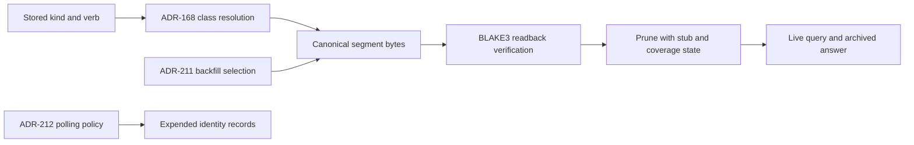
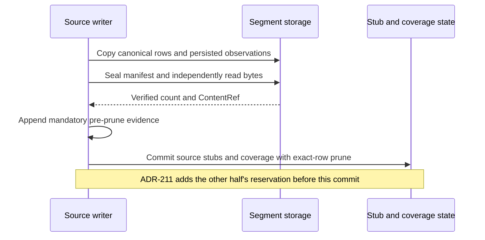

# ADR-168: Event Retention Classes and Sealed Archival

- **Status:** Proposed
- **Date:** 2026-08-20
- **Extends:** ADR-162 (adds a per-class contract dimension in the sense of its §4), ADR-022
  (two additive surface behaviours, §7 below)
- **Depends on:** ADR-004, ADR-005, ADR-007, ADR-018, ADR-022, ADR-041, ADR-046, ADR-094,
  ADR-103, ADR-106, ADR-108, ADR-161, ADR-162, ADR-163, ADR-164

## Context

The event plane is append-only by construction, and nothing bounds its lifetime. The
`EventStore` capability (ADR-005) exposes append, get, query, and count; it has no delete or
update surface, and the backing tables (`events`, `event_observations`) have no non-test
deletion path anywhere in the workspace. That is the correct write posture for an
authoritative record of what happened (ADR-004, ADR-162 §1), and it means growth is
unbounded by design, with no accepted decision stating a lifetime for any event class.

The pressure is no longer hypothetical. One long-running deployment has accumulated over
4.2 million event rows, and `brain.event_counts` (corrected by Amendment 3) refuses windows
matching more than 2 million events, so consumers of wide windows already operate against
population limits rather than against the full record. A store whose fact plane grows
without bound eventually taxes every query, checkpoint, and backup that shares the file.

Retention cannot be a single age cutoff, because the plane is not only an audit trail.
Accepted decisions make it load-bearing in four distinct ways:

1. **Event-sourced state.** Proposal lifecycles are reconstructed from events (ADR-046),
   and a scheduled row's replay authority is reconstructed from its creator-provenance
   events, never from mutable metadata (ADR-106). Removing those rows while their referent
   is live does not trim history; it deletes state.
2. **Provenance projection input.** ADR-041 projects provenance edges from the log; the log
   is the source the projection can be re-derived from.
3. **Accounting basis.** ADR-103 builds windowed resource attribution over the plane, and a
   windowed lifecycle comparison is only sound while both ends of the window are readable.
   ADR-018's `RateLimit` obligation is validated but explicitly unenforced in v0; when an
   admission or quota decision ships, it will need an accounting basis that does not reset,
   and a retention rule fixed after that decision would constrain it. Fixed now, retention
   can state the carry-forward rule such a decision inherits.
4. **Audit.** Dispatch audits, gate outcomes, and telemetry, the classes an age horizon
   serves well.

A uniform cutoff that is safe for the fourth silently breaks the first three. The unit at
which safety can be stated is the event class, and the plane already has the pattern for
per-class contract dimensions: attribution (ADR-162 §2), additive evolution (§3), write
posture (§4), and sink (ADR-164 §1). This decision adds the fifth dimension, lifetime ,
in the same form: a closed vocabulary, declared per class, with a fail-safe rule for
classes that have not declared.

## Decision

### 1. Retention class is a per-class contract dimension, from a closed three-value set

Every event class carries a retention class, joining attribution, additivity, write
posture, and sink as a per-class contract dimension. The vocabulary is closed:

- **`pinned_while_referenced`**, the class declares a referent and a terminal condition.
  Rows are ineligible for archival while their referent is live, and become age-eligible
  only after the referent reaches its terminal state. Examples of the shape: creator-
  provenance events for a schedulable row (referent: the row; terminal: the row is
  deleted or permanently deactivated per ADR-106's contract), proposal lifecycle events
  (referent: the proposal; terminal: a terminal lifecycle state per ADR-046), process
  lineage events (referent: the process record; terminal: a terminal process state per
  ADR-161).
- **`aggregate_then_archivable`**, the class declares a durable aggregate that must exist,
  and be verified, before rows in a window become eligible. The aggregate is itself a
  durable record with a stated home, written before eligibility and never reset by the
  archival that follows it. Any class serving quota or admission accounting takes this
  value: an aggregate that survives archival is what makes a non-resetting quota
  implementable over a bounded live store. The verification contract for an aggregate ,
  what is checked, against what, and recorded where, is defined at the first class
  assignment that takes this value, not inherited silently from this decision.
- **`age_archivable`**, rows are eligible on horizon age alone (§4). The value for pure
  audit and telemetry classes with no referent and no accounting consumer.

**A class with no declared retention class is retained indefinitely.** That is the absence
state, not a fourth vocabulary value, and it fails in the safe direction: nothing already
recorded becomes eligible for archival by default. §2 assigns a value to every class that
exists when this ADR is accepted (superseded by Amendment 3, Decision 2); the absence state remains the fallback for any
class a
later decision adds without declaring one. A newly introduced class must declare one of the
three values; omission is a rejection of the class definition, exactly as ADR-164 §2 treats
a missing sink declaration.

A class may additionally declare a **correlation key**, a payload field grouping rows into
units whose counts are compared against each other (ADR-163's restart-scan events pair an
opening count with a closing count keyed by boot identity, and its per-record terminal
events join the same unit; see §2's ADR-163 rows). Eligibility and segment assignment are
evaluated at correlation-unit granularity: a unit's rows archive together or not at all, so
a paired-count comparison never spans the horizon. This has a consequence beyond the
individual rows' own retention precondition: **a correlation-keyed unit is archive-eligible
only once it is complete** (its closing event exists on the plane), regardless of the age of
its individual rows. An incomplete unit, one whose opening has no matching closing, is
retained indefinitely by this rule alone, independent of any horizon, because there is no
closing count to compare against and archiving part of an incomplete unit would manufacture
the false completeness ADR-163 §2 exists to prevent.

**Class identity for a kind emitted by more than one site.** Most `EventKind` variants map
to exactly one emitting site with one set of retention needs. Examples of kinds with multiple emitting sites are:
(corrected by Amendment 3)
`Audit` and `FeedbackExplicit` are each constructed from multiple call sites whose rows
carry materially different referents, and an implementer who classifies by `kind` alone
collapses those referents into one class, which is exactly the failure this decision exists
to avoid. Every `Event` already carries a `verb` field (`crates/khive-types/src/event.rs`,
the verb that produced the event) independent of `payload`, and every constructor for these
two kinds uses a stable verb string (corrected by Amendment 3) (a constant such as
`schedule.creator_provenance`, or the dispatched `pack.verb` id). **For `Audit` and
`FeedbackExplicit`, `verb` is the class-key discriminator**: each distinct verb (or, for the
generic dispatch-audit case, the class of dispatched verbs with no dedicated kind of their
own) is its own row in §2's table, with its own retention value. No payload field is used as
the discriminator, because none of the constructors write one for this purpose; `verb` is
the field that already serves it in practice.

**The table key is exactly `(kind, verb)`, and it is not always one row per emitter.** Some
`(kind, verb)` pairs are constructed at more than one production call site, for example,
every git write verb (`git.commit`, `git.branch`, `git.update_ref`, `git.push`) is audited both by the generic
dispatch-audit path (`crates/khive-runtime/src/pack/dispatch.rs:404`, with success-row reduction specified by
ADR-103 Amendment 7, Accepted at `docs/adr/ADR-103-resource-attribution-model.md:1447`;
implemented at `crates/khive-runtime/src/pack/audit_success_rows.rs:217`) (corrected by Amendment 3) and
by a supplementary, verb-specific audit (`crates/khive-pack-git/src/write_handlers.rs`'s
`emit_write_audit`, ADR-108 rule 2), and `git.digest` is audited both by its own pinned
receipt (`crates/khive-runtime/src/pack/audit.rs:371`'s `persist_git_digest_receipt` (corrected by Amendment 3)) and, on
the
pre-receipt build-rejection path (`GitDigestReceiptOutcome::BuildRejected`) or when no receipt
outcome resolves at all, by the same generic dispatch/error audit
(`persist_intercepted_audit`); a receipt-append failure
(`GitDigestReceiptOutcome::PersistenceUnavailable`) deliberately produces no second best-effort
row (the runtime's documented single-append rule), so that outcome is a single-emitter case,
not a collapsed one. A `(kind, verb)` pair with more than one production emitter is
**one row, not several**: this decision does not key rows on emitter identity, only on
`(kind, verb)`. Where such a pair's emitters would otherwise imply different retention
classes, the row's class is **the safest of its emitters' classes**, ordered
`pinned_while_referenced` > `aggregate_then_archivable` > `age_archivable` (most protective
first), an implementer who classifies any row written under that `(kind, verb)` by the
weaker of two candidate classes has misclassified rows the stronger emitter requires
protected. Splitting a collapsed row into per-emitter rows is **out of scope for this table**
and requires a future amendment that first introduces a producer-stable discriminator
recorded in the event's own payload (for example, a typed audit subtype or producer-identity
field written by every constructor for that key), never an unstated convention inferred
from payload shape, and never a split that leaves any emitter's rows without a stated class.

### 2. The normative retention mapping

This table records the assigned `EventKind` variants, with exact-key exceptions and defaults
(superseded by Amendment 3, Decision 2), from the
production constructor sweep `rg -n "EventKind::" crates --glob '*.rs' --glob
'!**/tests/**'` plus a manual exclusion pass over `#[cfg(test)]` blocks the glob does not
reach (module-level `mod tests` inside otherwise-production files). A row marked
**no current production emitter** means the sweep found no non-test constructor for that
kind; the declared value is prospective, for whichever future change wires the kind, and the
kind's absence today does not exempt the row: omitting a declared kind from this table
would leave it in the indefinite-retention absence state by accident rather than by
decision.

This table is **prospective**: it governs which rows written from this ADR's acceptance
onward become archive-eligible under each class's precondition. It does not reach rows
already on the plane before a given class's assignment took effect; §9 states that
separately and is the governing contract for the existing 4.2-million-row population.

Rows marked **(provisional)** carry the safe-direction default. Their retention value is
normative as written, but their referent or terminal contract is not independently derived
from an owning ADR the way the proposal, schedule, and restart-boundary rows are. The owning
subsystem tightens a provisional row by amending this table, subject to the fail-closed and
monotone-tightening rule stated immediately below.

**Every provisional row fails closed until its contract is complete.** A provisional row is
**ineligible for archival** while any of the following is unresolved: its declared referent,
its terminal condition, its aggregate materialization (for an `aggregate_then_archivable`
row), or its verification contract. The row's stated class bounds what the row's behavior
may become once the contract resolves; it does not itself make the row archive-eligible.
Amending a provisional row must be **monotone toward a more specific contract with equal or
stronger protection**, naming a referent, a terminal condition, or a verification rule the
row previously lacked. **Reclassifying any row to a weaker class**, any move toward
`age_archivable` from `pinned_while_referenced` or `aggregate_then_archivable`, for a
provisional row or otherwise, is **out of scope for a table amendment to this ADR** and
requires a separate, independently reviewed ADR carrying its own backfill contract for rows
already written under the stronger class.

**Table A -- retention mapping.** The enumerated population is 43 variants, equal to `EventKind::ALL`
at `crates/khive-types/src/event.rs:186`, including the additions in rows A47-A49 and A58
(corrected by Amendment 3). This Proposed mapping is a contract for implementation after acceptance,
not a claim of implemented retention.
Table B remains outside the constructible population until its additive contracts land.

| #  | EventKind                       | Site / verb discriminator                                                                                                                                                                                                                                                                                                                                                                                                                                 | Retention class                           | Correlation key | Referent / terminal condition                                                                                                                                                                                                                                                                                                                                                                                                                                                                                            |
| -- | ------------------------------- | --------------------------------------------------------------------------------------------------------------------------------------------------------------------------------------------------------------------------------------------------------------------------------------------------------------------------------------------------------------------------------------------------------------------------------------------------------- | ----------------------------------------- | --------------- | ------------------------------------------------------------------------------------------------------------------------------------------------------------------------------------------------------------------------------------------------------------------------------------------------------------------------------------------------------------------------------------------------------------------------------------------------------------------------------------------------------------------------ |
| 1  | `Audit`                         | dispatch-audit fallback for canonical dispatched verbs without an exact Audit row. Sites: `crates/khive-runtime/src/pack/audit.rs:51` and `crates/khive-runtime/src/pack/dispatch.rs:404`. Excludes rows 2-7 and A50-A57. An exact key always wins over this fallback. (corrected by Amendment 3)                                                                                                                                                         | `age_archivable`                          | none            | Pure per-dispatch audit trail (ADR-018); no referent.                                                                                                                                                                                                                                                                                                                                                                                                                                                                    |
| 2  | `Audit`                         | schedule creator-provenance: `verb="schedule.creator_provenance"`. Site: `crates/khive-pack-schedule/src/handlers.rs:215`. Write posture: precondition. (corrected by Amendment 3)                                                                                                                                                                                                                                                                        | `pinned_while_referenced`                 | none            | Referent: the scheduled row (note). Terminal: the row is deleted or permanently deactivated per ADR-106.                                                                                                                                                                                                                                                                                                                                                                                                                 |
| 3  | `Audit`                         | schedule reminder delivery-failure: `verb="schedule.remind.fire"`. Site: `crates/khive-mcp/src/pending_events/recurrence.rs:223`. (corrected by Amendment 3)                                                                                                                                                                                                                                                                                              | `age_archivable`                          | none            | Best-effort telemetry of a delivery failure; no referent.                                                                                                                                                                                                                                                                                                                                                                                                                                                                |
| 4  | `Audit`                         | Collapsed Audit keys: `git.commit`, `git.branch`, `git.update_ref`, `git.push`, `git.pr_open`, `git.pr_review`, `git.pr_merge`. Generic dispatch site: `crates/khive-runtime/src/pack/audit.rs:51`; supplementary site: `crates/khive-pack-git/src/write_handlers.rs:582`, called for all seven verbs at `crates/khive-pack-git/src/local_handlers.rs:869`. Both emitters share each exact key under the collision rule in §1. (corrected by Amendment 3) | `age_archivable`                          | none            | Decoupled dispatch-style audit of a git write action; the action's own effect lives in the git repository, this row is the khive-side record. Both emitters agree on `age_archivable`, so the safest-of-emitters class is unchanged from either alone.                                                                                                                                                                                                                                                                   |
| 5  | `Audit`                         | Collapsed `verb="git.digest"`: receipt at `crates/khive-runtime/src/pack/audit.rs:371`; generic fallback at `crates/khive-runtime/src/pack/dispatch.rs:384`. `BuildRejected` permits the fallback; `PersistenceUnavailable` does not, per `crates/khive-runtime/src/pack/audit.rs:334`. Receipt write posture: coupled-outcome. (corrected by Amendment 3)                                                                                                | `pinned_while_referenced` (provisional)   | none            | Referent: the ingested project/digest record (`project_id`), for rows written by the receipt emitter; rows written by the fallback generic-audit emitter (the `BuildRejected`/no-outcome paths) carry no referent, but the collapsed row is still classified at the safest of the two, `pinned_while_referenced` dominates `age_archivable`. Terminal: not yet named; a superseding receipt for the same `project_id` may or may not retire the prior one, and confirmation belongs to a git-pack amendment of this row. |
| 6  | `Audit`                         | moodboard serve record: `verb=SERVE_RECORD_VERB`. Site: `crates/khive-pack-moodboard/src/preference_handlers.rs:987` (`.with_aggregate("moodboard_serve", ...)`). Write posture: precondition (event-sourced aggregate). (corrected by Amendment 3)                                                                                                                                                                                                       | `pinned_while_referenced` (provisional)   | none            | Referent: the moodboard serve aggregate (`serve_id` / `board_entity_id`). Terminal: not named by ADR-148/149; confirmation belongs to a moodboard-pack amendment of this row.                                                                                                                                                                                                                                                                                                                                            |
| 7  | `Audit`                         | moodboard model record: `verb=MODEL_RECORD_VERB`. Site: `crates/khive-pack-moodboard/src/preference_handlers.rs:1431`. (corrected by Amendment 3)                                                                                                                                                                                                                                                                                                         | `pinned_while_referenced` (provisional)   | none            | Referent: the moodboard model aggregate (`model.id`). Terminal: not named; confirmation belongs to a moodboard-pack amendment of this row.                                                                                                                                                                                                                                                                                                                                                                               |
| 8  | `FeedbackExplicit`              | brain feedback: `verb="brain.feedback"`. Site: `crates/khive-pack-brain/src/handlers/brain_handlers.rs:1178`, folded by `crates/khive-pack-brain/src/fold.rs`. (corrected by Amendment 3)                                                                                                                                                                                                                                                                 | `aggregate_then_archivable` (provisional) | none            | Aggregate: the brain profile posterior snapshot these events are folded into. Verification contract (what is checked against what, recorded where) is deferred to a khive-pack-brain-owning follow-up per §1's rule that it is not inherited silently from this ADR.                                                                                                                                                                                                                                                     |
| 9  | `FeedbackExplicit`              | moodboard judgment: `verb=JUDGMENT_RECORD_VERB`. Site: `crates/khive-pack-moodboard/src/preference_handlers.rs:1063` (`.with_aggregate("moodboard_judgment", ...)`). Write posture: precondition. (corrected by Amendment 3)                                                                                                                                                                                                                              | `pinned_while_referenced` (provisional)   | none            | Referent: the moodboard judgment aggregate. Terminal: not named; confirmation belongs to a moodboard-pack amendment of this row.                                                                                                                                                                                                                                                                                                                                                                                         |
| 10 | `RecallExecuted`                | Production site: `crates/khive-pack-memory/src/handlers/recall.rs:1588`. (corrected by Amendment 3)                                                                                                                                                                                                                                                                                                                                                       | `age_archivable`                          | none            | Pure telemetry of a recall call; feedback targets the recalled entity/note by id, never this event, so nothing downstream holds a reference to this row.                                                                                                                                                                                                                                                                                                                                                                 |
| 11 | `RerankExecuted`                | Production emitter: `crates/khive-pack-memory/src/handlers/sub_handlers.rs:487`, `verb="memory.recall_rerank"`. (corrected by Amendment 3)                                                                                                                                                                                                                                                                                                                | `age_archivable`                          | none            | Telemetry, matching its sibling kinds (10, 12). (corrected by Amendment 3)                                                                                                                                                                                                                                                                                                                                                                                                                                               |
| 12 | `SearchExecuted`                | Production site: `crates/khive-pack-kg/src/handlers/search.rs:782`. (corrected by Amendment 3)                                                                                                                                                                                                                                                                                                                                                            | `age_archivable`                          | none            | Same shape as row 10.                                                                                                                                                                                                                                                                                                                                                                                                                                                                                                    |
| 13 | `ChannelPollStarted`            | Production site: `crates/khive-mcp/src/serve/channel_poll.rs:104`. (corrected by Amendment 3)                                                                                                                                                                                                                                                                                                                                                             | `age_archivable`                          | none            | ADR-094 sequencing telemetry.                                                                                                                                                                                                                                                                                                                                                                                                                                                                                            |
| 14 | `ChannelPollSucceeded`          | Production site: `crates/khive-mcp/src/serve/channel_poll.rs:180`. (corrected by Amendment 3)                                                                                                                                                                                                                                                                                                                                                             | `age_archivable`                          | none            | Same.                                                                                                                                                                                                                                                                                                                                                                                                                                                                                                                    |
| 15 | `ChannelPollFailed`             | Production site: `crates/khive-mcp/src/serve/channel_poll.rs:488`. (corrected by Amendment 3)                                                                                                                                                                                                                                                                                                                                                             | `age_archivable`                          | none            | Same.                                                                                                                                                                                                                                                                                                                                                                                                                                                                                                                    |
| 16 | `ChannelBackoffArmed`           | Production site: `crates/khive-mcp/src/serve/channel_poll.rs:508`. (corrected by Amendment 3)                                                                                                                                                                                                                                                                                                                                                             | `age_archivable`                          | none            | Same.                                                                                                                                                                                                                                                                                                                                                                                                                                                                                                                    |
| 17 | `ChannelBackoffReset`           | Production site: `crates/khive-mcp/src/serve/channel_poll.rs:191`. (corrected by Amendment 3)                                                                                                                                                                                                                                                                                                                                                             | `age_archivable`                          | none            | Same.                                                                                                                                                                                                                                                                                                                                                                                                                                                                                                                    |
| 18 | `ChannelHeartbeatPersistFailed` | Production site: `crates/khive-mcp/src/serve/channel_poll.rs:665`. (corrected by Amendment 3)                                                                                                                                                                                                                                                                                                                                                             | `age_archivable`                          | none            | Same.                                                                                                                                                                                                                                                                                                                                                                                                                                                                                                                    |
| 19 | `ConfigLocked`                  | Production site: `crates/khive-runtime/src/pack/dispatch.rs:759`. (corrected by Amendment 3)                                                                                                                                                                                                                                                                                                                                                              | `age_archivable`                          | none            | Process-lifetime diagnostic; deliberately excluded from per-verb receipt counts (see the code comment at the site).                                                                                                                                                                                                                                                                                                                                                                                                      |
| 20 | `CheckpointOutcomeRecorded`     | Production site: `crates/khive-db/src/checkpoint/task_loop.rs:490`. (corrected by Amendment 3)                                                                                                                                                                                                                                                                                                                                                            | `age_archivable`                          | none            | WAL checkpoint telemetry.                                                                                                                                                                                                                                                                                                                                                                                                                                                                                                |
| 21 | `PhaseStarted`                  | Production sites: `crates/khive-pack-kg/src/dispatch.rs:54`, `crates/khive-pack-knowledge/src/pack.rs:138`, `crates/khive-pack-memory/src/ann/warm.rs:473`, `crates/khive-pack-brain/src/handlers/brain_handlers.rs:1520`. (corrected by Amendment 3)                                                                                                                                                                                                     | `age_archivable`                          | none            | ADR-103 Stage 1 background-phase telemetry.                                                                                                                                                                                                                                                                                                                                                                                                                                                                              |
| 22 | `PhaseCompleted`                | Production sites: `crates/khive-pack-kg/src/dispatch.rs:91`, `crates/khive-pack-knowledge/src/pack.rs:177`, `crates/khive-pack-memory/src/ann/warm.rs:534`. (corrected by Amendment 3)                                                                                                                                                                                                                                                                    | `age_archivable`                          | none            | Same.                                                                                                                                                                                                                                                                                                                                                                                                                                                                                                                    |
| 23 | `PhaseCancelled`                | Production sites: `crates/khive-pack-kg/src/dispatch.rs:76`, `crates/khive-pack-knowledge/src/pack.rs:162`, `crates/khive-pack-memory/src/ann/warm.rs:519`. (corrected by Amendment 3)                                                                                                                                                                                                                                                                    | `age_archivable`                          | none            | Same.                                                                                                                                                                                                                                                                                                                                                                                                                                                                                                                    |
| 24 | `EmbedderInitialized`           | Production site: `crates/khive-runtime/src/runtime/embedder_init.rs:93`. (corrected by Amendment 3)                                                                                                                                                                                                                                                                                                                                                       | `age_archivable`                          | none            | Process lifecycle diagnostic, distinct from `EmbeddingModelChanged` (row 41).                                                                                                                                                                                                                                                                                                                                                                                                                                            |
| 25 | `EntityCreated`                 | Production emitter: `crates/khive-runtime/src/operations/entity_create.rs:9`, `verb="create"`; the structural event coexists with the generic Audit key. (corrected by Amendment 3)                                                                                                                                                                                                                                                                       | `pinned_while_referenced`                 | none            | Referent: the created entity. Terminal: the entity is hard-deleted. (corrected by Amendment 3)                                                                                                                                                                                                                                                                                                                                                                                                                           |
| 26 | `EntityUpdated`                 | Production site: `crates/khive-runtime/src/atomic_prepare/add_update.rs:975`; `crates/khive-runtime/src/curation/entity_curation.rs:581`. (corrected by Amendment 3)                                                                                                                                                                                                                                                                                      | `pinned_while_referenced`                 | none            | Referent: the target entity (`target_id`). Terminal: the entity is hard-deleted (cascade removes incident edges).                                                                                                                                                                                                                                                                                                                                                                                                        |
| 27 | `EntityDeleted`                 | Production site: `crates/khive-runtime/src/atomic_prepare/edge_delete.rs:422`. (corrected by Amendment 3)                                                                                                                                                                                                                                                                                                                                                 | `pinned_while_referenced`                 | none            | Referent: the deleted entity. Terminal: the entity is hard-deleted; for a hard-delete's own event, the referent is already terminal at write time, while for a soft-delete's event, the row stays pinned until a later hard delete.                                                                                                                                                                                                                                                                                      |
| 28 | `EntityMerged`                  | Production site: `crates/khive-runtime/src/curation/entity_curation.rs:760`. (corrected by Amendment 3)                                                                                                                                                                                                                                                                                                                                                   | `pinned_while_referenced`                 | none            | Referent: the kept entity (`summary.kept_id`). Terminal: the kept entity is hard-deleted.                                                                                                                                                                                                                                                                                                                                                                                                                                |
| 29 | `NoteCreated`                   | Note creation: `crates/khive-runtime/src/operations.rs:1483`; graph-lint creation: `crates/khive-runtime/src/graph_lint/fix.rs:266`. Both use `verb="create"`; this is not confined to `memory.remember`. (corrected by Amendment 3)                                                                                                                                                                                                                      | `pinned_while_referenced`                 | none            | Referent: the created note. Terminal: the note is hard-deleted (ordinary `memory.prune` only soft-deletes per ADR-021). (corrected by Amendment 3)                                                                                                                                                                                                                                                                                                                                                                       |
| 30 | `NoteUpdated`                   | Production emitter: `crates/khive-runtime/src/note_write.rs:1062`, `verb="update"`, in the update transaction. (corrected by Amendment 3)                                                                                                                                                                                                                                                                                                                 | `pinned_while_referenced`                 | none            | Referent: the updated note. Terminal: the note is hard-deleted. (corrected by Amendment 3)                                                                                                                                                                                                                                                                                                                                                                                                                               |
| 31 | `NoteDeleted`                   | Production site: `crates/khive-runtime/src/atomic_prepare/edge_delete.rs:622`. (corrected by Amendment 3)                                                                                                                                                                                                                                                                                                                                                 | `pinned_while_referenced`                 | none            | Same shape as row 27, for notes.                                                                                                                                                                                                                                                                                                                                                                                                                                                                                         |
| 32 | `NoteMerged`                    | Production site: `crates/khive-runtime/src/curation/note_merge.rs:191`. (corrected by Amendment 3)                                                                                                                                                                                                                                                                                                                                                        | `pinned_while_referenced`                 | none            | Referent: the kept note. Terminal: the kept note is hard-deleted.                                                                                                                                                                                                                                                                                                                                                                                                                                                        |
| 33 | `LinkCreated`                   | Production link plan: `crates/khive-runtime/src/atomic_prepare/link_merge.rs:154`. (corrected by Amendment 3)                                                                                                                                                                                                                                                                                                                                             | `pinned_while_referenced`                 | none            | Referent: the created edge. Terminal: the edge is deleted.                                                                                                                                                                                                                                                                                                                                                                                                                                                               |
| 34 | `EdgeUpdated`                   | Production site: `crates/khive-runtime/src/atomic_prepare/edge_delete.rs:229`. (corrected by Amendment 3)                                                                                                                                                                                                                                                                                                                                                 | `pinned_while_referenced`                 | none            | Referent: the target edge. Terminal: the edge is deleted.                                                                                                                                                                                                                                                                                                                                                                                                                                                                |
| 35 | `EdgeDeleted`                   | Production site: `crates/khive-runtime/src/atomic_prepare/edge_delete.rs:550`. (corrected by Amendment 3)                                                                                                                                                                                                                                                                                                                                                 | `pinned_while_referenced`                 | none            | Referent: the deleted edge. Terminal: already reached at write time.                                                                                                                                                                                                                                                                                                                                                                                                                                                     |
| 36 | `TaskTransitioned`              | No current production emitter (`gtd.transition` records under row 1 instead).                                                                                                                                                                                                                                                                                                                                                                             | `pinned_while_referenced`                 | none            | Prospective. Referent: the task note. Terminal: the task note is hard-deleted (reaching a GTD-terminal status such as `done`/`cancelled` is not itself retention-terminal; the note is still a live KG record).                                                                                                                                                                                                                                                                                                          |
| 37 | `ProposalCreated`               | Production site: `crates/khive-pack-kg/src/handlers/proposal.rs:310`. (corrected by Amendment 3)                                                                                                                                                                                                                                                                                                                                                          | `pinned_while_referenced`                 | none            | Referent: the proposal. Terminal: a terminal lifecycle state per ADR-046.                                                                                                                                                                                                                                                                                                                                                                                                                                                |
| 38 | `ProposalReviewed`              | Production site: `crates/khive-pack-kg/src/handlers/proposal.rs:430`. (corrected by Amendment 3)                                                                                                                                                                                                                                                                                                                                                          | `pinned_while_referenced`                 | none            | Same.                                                                                                                                                                                                                                                                                                                                                                                                                                                                                                                    |
| 39 | `ProposalApplied`               | Production site: `crates/khive-pack-kg/src/apply_worker/worker.rs:772`. (corrected by Amendment 3)                                                                                                                                                                                                                                                                                                                                                        | `pinned_while_referenced`                 | none            | Same.                                                                                                                                                                                                                                                                                                                                                                                                                                                                                                                    |
| 40 | `ProposalWithdrawn`             | Production site: `crates/khive-pack-kg/src/handlers/proposal.rs:542`. (corrected by Amendment 3)                                                                                                                                                                                                                                                                                                                                                          | `pinned_while_referenced`                 | none            | Same.                                                                                                                                                                                                                                                                                                                                                                                                                                                                                                                    |
| 41 | `EmbeddingModelChanged`         | No current production emitter.                                                                                                                                                                                                                                                                                                                                                                                                                            | `pinned_while_referenced` (provisional)   | none            | Referent: the embedding model version this describes. Terminal: superseded by the next `EmbeddingModelChanged` naming the same model subject, or a future embedding-subsystem ADR names one.                                                                                                                                                                                                                                                                                                                             |
| 42 | `EmbeddingMigrationCompleted`   | No current production emitter.                                                                                                                                                                                                                                                                                                                                                                                                                            | `pinned_while_referenced` (provisional)   | none            | Same shape as row 41.                                                                                                                                                                                                                                                                                                                                                                                                                                                                                                    |
| 43 | `EmbeddingMigrationFailed`      | No current production emitter.                                                                                                                                                                                                                                                                                                                                                                                                                            | `pinned_while_referenced` (provisional)   | none            | Same shape as row 41.                                                                                                                                                                                                                                                                                                                                                                                                                                                                                                    |
| 44 | `EmbeddingDriftDetected`        | No current production emitter.                                                                                                                                                                                                                                                                                                                                                                                                                            | `pinned_while_referenced` (provisional)   | none            | Same shape as row 41.                                                                                                                                                                                                                                                                                                                                                                                                                                                                                                    |
| 45 | `ProfileResolutionRecommended`  | No current production emitter.                                                                                                                                                                                                                                                                                                                                                                                                                            | `pinned_while_referenced` (provisional)   | none            | Referent: the brain profile this recommends resolving. Terminal: superseded by the next event of the same kind for the same profile, or a follow-up names one.                                                                                                                                                                                                                                                                                                                                                           |
| 46 | `ProfileMerged`                 | No current production emitter.                                                                                                                                                                                                                                                                                                                                                                                                                            | `pinned_while_referenced` (provisional)   | none            | Referent: the kept profile. Terminal: same shape as row 45.                                                                                                                                                                                                                                                                                                                                                                                                                                                              |

Table A additions (corrected by Amendment 3; see Decision 3). The A-prefixed row identities preserve Table B's existing
row numbers.
Rows A49-A58 use the provisional pinned class. Their owning records have not stated terminal conditions,
so §2's fail-closed rule makes them ineligible for archival.

| #   | EventKind          | Site / verb discriminator                                                                                                                                        | Retention class                         | Correlation key | Referent / terminal condition                                                                                                                                                                                                                                                                                         |
| --- | ------------------ | ---------------------------------------------------------------------------------------------------------------------------------------------------------------- | --------------------------------------- | --------------- | --------------------------------------------------------------------------------------------------------------------------------------------------------------------------------------------------------------------------------------------------------------------------------------------------------------------- |
| A47 | `ToolCheckDecided` | `tool.check`; `crates/khive-pack-tool/src/policy.rs:857`.                                                                                                        | `age_archivable`                        | none            | Decision telemetry; `docs/adr/ADR-180-tool-pack.md:672` specifies this class.                                                                                                                                                                                                                                         |
| A48 | `FeedbackUnjudged` | `brain.feedback`; `crates/khive-pack-brain/src/handlers/auto_feedback.rs:324`.                                                                                   | `age_archivable`                        | none            | Serve telemetry that does not train a profile or enter its private log (`crates/khive-pack-brain/src/handlers/auto_feedback.rs:318`).                                                                                                                                                                                 |
| A49 | `Refusal`          | `knowledge.upsert_atoms`; `crates/khive-pack-knowledge/src/knowledge/refusal.rs:165`.                                                                            | `pinned_while_referenced` (provisional) | none            | Referent: the existing knowledge atom named by `target_id` (`crates/khive-pack-knowledge/src/knowledge/refusal.rs:172`). The knowledge lifecycle record has not stated its terminal condition; ineligible for archival until it does.                                                                                 |
| A50 | `Audit`            | Collapsed `create`: generic dispatch plus `crates/khive-runtime/src/secret_gate_finalizer/entity_transaction.rs:118`.                                            | `pinned_while_referenced` (provisional) | none            | Referent: the written entity named by `target_id` and payload `record_id` (`crates/khive-runtime/src/secret_gate_finalizer/entity_transaction.rs:126`). Secret-gate exemption evidence. Terminal condition unstated by the owning record; ineligible for archival.                                                    |
| A51 | `Audit`            | Collapsed `update`: the same finalizer; verb at `crates/khive-runtime/src/secret_gate_finalizer/entity_admission.rs:39`.                                         | `pinned_while_referenced` (provisional) | none            | Referent: the updated entity named by `target_id` and payload `record_id` (`crates/khive-runtime/src/secret_gate_finalizer/entity_transaction.rs:126`). Secret-gate exemption evidence. Terminal condition unstated by the owning record; ineligible for archival.                                                    |
| A52 | `Audit`            | Collapsed `code.ingest`: the same finalizer; verb at `crates/khive-runtime/src/secret_gate_finalizer/entity_admission.rs:40`.                                    | `pinned_while_referenced` (provisional) | none            | Referent: the ingested entity named by `target_id` and payload `record_id` (`crates/khive-runtime/src/secret_gate_finalizer/entity_transaction.rs:126`). Secret-gate exemption evidence, including direct ingest. Terminal condition unstated by the owning record; ineligible for archival.                          |
| A53 | `Audit`            | Collapsed `code.findings_ingest`: the same finalizer; verb at `crates/khive-runtime/src/secret_gate_finalizer/entity_admission.rs:41`.                           | `pinned_while_referenced` (provisional) | none            | Referent: the written findings entity named by `target_id` and payload `record_id` (`crates/khive-runtime/src/secret_gate_finalizer/entity_transaction.rs:126`). Secret-gate exemption evidence. Terminal condition unstated by the owning record; ineligible for archival.                                           |
| A54 | `Audit`            | Collapsed `comm.suppression_remove`: `crates/khive-pack-comm/src/handlers/suppression.rs:211`.                                                                   | `pinned_while_referenced` (provisional) | none            | Referent: the suppression entry named by `target_id` and payload `entry_id` (`crates/khive-pack-comm/src/handlers/suppression.rs:218`). Removal authorization evidence. Terminal condition unstated by the owning record; ineligible for archival.                                                                    |
| A55 | `Audit`            | Collapsed `comm.withheld_body`: `crates/khive-pack-comm/src/handlers/withheld_body.rs:40`.                                                                       | `pinned_while_referenced` (provisional) | none            | Referent: the withheld message named by `target_id` when resolved (`crates/khive-pack-comm/src/handlers/withheld_body.rs:57`). Access evidence includes denied or unavailable originals. An unresolved message fails closed; terminal condition unstated by the owning record; ineligible for archival.               |
| A56 | `Audit`            | Collapsed `delete`: `crates/khive-db/src/stores/event.rs:651`.                                                                                                   | `pinned_while_referenced` (provisional) | none            | Referent: the hard-deleted record named by `target_id` and payload `deleted_id` (`crates/khive-db/src/stores/event.rs:680`). Lineage-loss evidence includes the removed incident edges. Deletion alone does not supply this evidence's terminal condition; unstated by the owning record, so ineligible for archival. |
| A57 | `Audit`            | Collapsed `mount.repin`: `crates/khive-mounts/src/lib.rs:88`.                                                                                                    | `pinned_while_referenced` (provisional) | none            | Referent: the mount catalog entry named by payload `mount`, with the changed `generation` (`crates/khive-mounts/src/lib.rs:85`). Catalog-change evidence shares the configuration transaction (`crates/khive-mounts/src/store.rs:60`). Terminal condition unstated by the owning record; ineligible for archival.     |
| A58 | `GrantChange`      | `grant`, `revoke`, `retire_anchor`; `crates/khive-capability/src/authority_store/history.rs:22` and `crates/khive-capability/src/authority_store/history.rs:90`. | `pinned_while_referenced` (provisional) | none            | Referent: the authority record identified by `record_id` within its authority epoch (`crates/khive-db/src/authority.rs:296`). ADR-143 has not stated its archival terminal condition; ineligible for archival until it does.                                                                                          |

Each collapsed Audit row reserves one exact key across all its emitters, including the generic dispatch constructor
at `crates/khive-runtime/src/pack/audit.rs:51` whenever that verb is dispatched. It does not assert that a direct-only
entry point is registered for dispatch. Each shared key resolves to `pinned_while_referenced`, the strongest value
in §1's order, and cannot fall through to row 1's weaker age rule. These assignments satisfy the declaration
requirement; archival eligibility still fails closed until the owning records state their terminal conditions.

**Table B, declared-future rows, gated.** The six rows below name kinds that are **not**
in the current `EventKind::ALL` (43 variants at `crates/khive-types/src/event.rs:186`; (corrected by Amendment 3)). They
are not part of the closed population
this Proposed ADR declares. (corrected by Amendment 3) Each group becomes normative, and its rows join Table A, only
when
its own additive event contract lands in full: a new `EventKind` variant, registration in
`EventKind::ALL`, a typed payload (not a prose field list), stated schema-version behavior,
and observation-decoding support (`crates/khive-db/src/stores/event.rs`'s per-kind decoders,
which today have no branch for any of these six kinds). **A consumer MUST NOT treat Table B
as part of the closed population until that contract lands**; until then, treating these
kinds as constructible, queryable, or enumerable is a misreading of this ADR. The three
`ADR-163` rows remain gated: `docs/adr/ADR-163-restart-boundary-event-legibility.md:3` marks that record withdrawn.
They have no accepted event contract and remain outside Table A (corrected by Amendment 3).

| #  | EventKind                                                                       | Site / verb discriminator                                                                                                                                                              | Retention class           | Correlation key | Referent / terminal condition                                                                                                                 |
| -- | ------------------------------------------------------------------------------- | -------------------------------------------------------------------------------------------------------------------------------------------------------------------------------------- | ------------------------- | --------------- | --------------------------------------------------------------------------------------------------------------------------------------------- |
| 47 | `RestartScanOpened` (ADR-163; not yet in `EventKind::ALL`)                      | Boot scan, emitted before any per-record event.                                                                                                                                        | `age_archivable`          | `boot_id`       | Runtime-system-actor telemetry once complete; see §1's completeness rule: this unit is ineligible until row 49 exists for the same `boot_id`. |
| 48 | `RecordTerminatedAtRestart` (ADR-163; not yet in `EventKind::ALL`)              | Boot scan, one per terminated record.                                                                                                                                                  | `age_archivable`          | `boot_id`       | Same unit as rows 47/49.                                                                                                                      |
| 49 | `RestartScanClosed` (ADR-163; not yet in `EventKind::ALL`)                      | Boot scan, emitted after per-record events.                                                                                                                                            | `age_archivable`          | `boot_id`       | Same unit; this event's presence is what makes the unit complete.                                                                             |
| 50 | `ArchiveSegmentSealed` (this ADR, §5; not yet in `EventKind::ALL`)              | Archival worker, one per sealed segment.                                                                                                                                               | `pinned_while_referenced` | none            | Referent: the segment. Terminal: destruction of the segment (§6).                                                                             |
| 51 | `ArchiveRowsPruned` (this ADR, §5; not yet in `EventKind::ALL`)                 | Archival worker, one per prune.                                                                                                                                                        | `pinned_while_referenced` | none            | Same shape as row 50.                                                                                                                         |
| 52 | `ArchiveSegmentAccessAttempted` (this ADR, §5, §6; not yet in `EventKind::ALL`) | Operator unseal/restore/replace/delete action: one attempt row per attempt, plus one completion row when an allowed action's effect runs (§5) (superseded by Amendment 3, Decision 3). | `pinned_while_referenced` | none            | Same shape as row 50.                                                                                                                         |

### 3. Archival is copy-then-seal-then-verify; the plane as a whole stays append-only

Archival moves eligible rows into **sealed segments** outside the live store:

1. **Copy.** Rows eligible under §1/§2 and older than the horizon (§4) are copied, with their
   `event_observations` rows, into a new segment, an append-only artifact outside the live
   database file. Segment format and placement are operator-owned configuration; the
   contract is on the manifest and the verification, not the container. (superseded by Amendment 3, Decision 4)
2. **Seal.** The segment closes with a manifest recording: segment identity, the classes it
   contains, row count, the covered `created_at` range, and a content digest computed over
   the segment's rows.
3. **Verify.** Before any pruning, the sealed segment is independently re-read: row count
   and content digest are recomputed from the segment and compared against the manifest.
   A mismatch voids the segment; nothing is pruned against it.

Only after verification may the live store be pruned, and pruning is bounded to exactly the
rows proven present in the verified segment, the deletion's row set is derived from the
segment readback, not from re-evaluating the eligibility predicate, so a row that became
eligible after the copy cannot be deleted without having been archived.

This is the one conscious amendment to the plane's append-only posture, and it is scoped:
the **live table** loses rows only to a verified sealed copy, and the **plane as a whole**
, live store plus sealed segments, remains append-only. §6 states the one narrow exception
this decision allows for a sealed segment's own destruction; short of that exception, no
information is destroyed.

### 4. The horizon is operator configuration, and archival is off by default

Eligibility requires `created_at` older than a configured horizon in addition to the
class's own precondition. The horizon's value is operator-owned configuration; this
decision fixes the mechanism, not the number. **Unset means archival does not run.** A
deployment that never configures a horizon keeps today's behaviour exactly, and no
migration or backfill occurs on upgrade. §9 states the historical-row contract this
implies in full.

### 5. Archival actions are themselves events, recorded ahead of the destructive step

The retention machinery emits its own event classes, declared here with all five
dimensions (attribution, additivity, write posture, sink, retention). All three are
additive `EventKind` variants per ADR-162 §3: never removed, never repurposed, no payload
field redefined once shipped. Landing any of the three requires the full additive
contract: a new `EventKind` variant, registration in `EventKind::ALL`
(`crates/khive-types/src/event.rs`), the typed payload declared below (not the prose field
lists this section previously used), a stated payload schema version, and an
observation-decoding branch in `crates/khive-db/src/stores/event.rs`. Until all five land
for a given kind, it remains a Table B row (§2) and is not part of the closed population.

- **`ArchiveSegmentSealed`**: one per sealed segment. Typed payload:

  | Field              | Type                                         | Nullable | Semantics                                                                 |
  | ------------------ | -------------------------------------------- | -------- | ------------------------------------------------------------------------- |
  | `segment_id`       | `Uuid`                                       | no       | Identity of the sealed segment.                                           |
  | `classes`          | `Vec<String>`                                | no       | The retention classes (§1) represented in the segment; non-empty.         |
  | `row_count`        | `i64`                                        | no       | Count of rows copied into the segment.                                    |
  | `covered_range`    | `{ from: DateTime<Utc>, to: DateTime<Utc> }` | no       | The segment's `created_at` span.                                          |
  | `content_digest`   | `String`                                     | no       | Content digest computed over the segment's rows (§3).                     |
  | `manifest_version` | `i64`                                        | no       | Version of the manifest schema this segment's manifest was written under. |

  Attribution: the daemon principal (runtime background work, the ADR-162 §2 form). Sink:
  `caller_event_store`. Write posture: **precondition**: the event is appended and
  durable before any prune against that segment may run; if the append fails, the prune
  does not run. Retention class: `pinned_while_referenced`, referent the segment
  itself; terminal condition: destruction of the segment (§6). Manifests are therefore
  effectively permanent, which is intended, since the manifest must outlive everything it
  vouches for.
- **`ArchiveRowsPruned`**: one per prune. Typed payload:

  | Field                  | Type     | Nullable | Semantics                                                       |
  | ---------------------- | -------- | -------- | --------------------------------------------------------------- |
  | `segment_id`           | `Uuid`   | no       | The segment pruned against.                                     |
  | `row_count_removed`    | `i64`    | no       | Count of live rows deleted in this prune.                       |
  | `manifest_digest`      | `String` | no       | Content digest recorded in the segment's manifest (§3).         |
  | `recomputed_digest`    | `String` | no       | Content digest recomputed from the segment at verify time (§3). |
  | `manifest_row_count`   | `i64`    | no       | Row count recorded in the segment's manifest.                   |
  | `recomputed_row_count` | `i64`    | no       | Row count recomputed from the segment at verify time.           |

  Same attribution and sink as `ArchiveSegmentSealed`. Write posture: precondition,
  appended before the delete executes. Retention class: `pinned_while_referenced`,
  referent the segment; terminal condition: destruction of the segment.
- **`ArchiveSegmentAccessAttempted`**: appended for every unseal, restore, replace, or
  delete attempt against a sealed segment (§6), success or failure. A denied attempt
  produces exactly one row (`stage: "attempt"`), as does an allowed `unseal`/`restore`
  whose digest verification fails (no effect runs). Every allowed attempt whose effect
  runs produces exactly two rows sharing one `attempt_id`: an attempt row appended before
  the effect and a completion row appended after the effect concludes (superseded by Amendment 3, Decision 3), the event
  plane is
  append-only (§1), so the effect's final outcome is carried by its own row, never by
  mutating the attempt row. Typed payload:

  | Field                         | Type                                                             | Nullable | Semantics                                                                                                                                                                                                                                                                                                                                                                                                                      |
  | ----------------------------- | ---------------------------------------------------------------- | -------- | ------------------------------------------------------------------------------------------------------------------------------------------------------------------------------------------------------------------------------------------------------------------------------------------------------------------------------------------------------------------------------------------------------------------------------ |
  | `segment_id`                  | `Uuid`                                                           | no       | The segment the attempt targets.                                                                                                                                                                                                                                                                                                                                                                                               |
  | `attempt_id`                  | `Uuid`                                                           | no       | Unique per attempt; identical on an attempt row and its completion row, which is how a reader joins the pair (§6).                                                                                                                                                                                                                                                                                                             |
  | `stage`                       | `"attempt" \| "completion"`                                      | no       | `attempt` rows are appended before the action's effect (the precondition posture below). `completion` rows exist for every allowed action whose effect ran, are appended after the effect concludes, and carry its outcome evidence (§6) (superseded by Amendment 3, Decision 3).                                                                                                                                              |
  | `action`                      | `"unseal" \| "restore" \| "replace_segment" \| "delete_segment"` | no       | The canonical action attempted; `replace_segment` and `delete_segment` are distinguishable by this value alone (§6).                                                                                                                                                                                                                                                                                                           |
  | `gate_decision`               | `"allow" \| "deny"`                                              | no       | The Gate's decision for this attempt (ADR-018).                                                                                                                                                                                                                                                                                                                                                                                |
  | `digest_verified`             | `"true" \| "false" \| "unknown"`                                 | no       | Tri-state, present for every action. See below for the required value per action and outcome.                                                                                                                                                                                                                                                                                                                                  |
  | `replacement_segment_id`      | `Uuid`                                                           | yes      | Identity of the replacement segment (§6). Required on both rows of an allowed `replace_segment` (it is known before the effect: the replacement is sealed per §3 before this action runs); null for `unseal`, `restore`, and `delete_segment`, and null on a denied `replace_segment` attempt, a denied request's replacement-only fields are all null, whatever the request supplied.                                         |
  | `pre_replace_digest`          | `String`                                                         | yes      | Content digest of the segment being replaced, read from its manifest, not recomputed (§6). Same nullability as `replacement_segment_id`.                                                                                                                                                                                                                                                                                       |
  | `post_replace_digest`         | `String`                                                         | yes      | Content digest of the replacement segment, from its own `ArchiveSegmentSealed` manifest (§6). Same nullability as `replacement_segment_id`.                                                                                                                                                                                                                                                                                    |
  | `manifest_version`            | `i64`                                                            | yes      | Version of the manifest that publishes the supersession pointer from the original `segment_id` to `replacement_segment_id` (§6). Completion rows only: set when and only when the version pointer was written; null on attempt rows and on a completion row whose failure preceded the pointer write.                                                                                                                          |
  | `replace_verification_status` | `"verified" \| "failed" \| "not_attempted"`                      | yes      | Strictly the result of the replacement segment's independent pre-publish re-verification (§6), nothing else: `verified` = it ran and passed; `failed` = it ran and mismatched; `not_attempted` = the replace sequence failed before reaching it. Completion rows of `replace_segment` only; null everywhere else. A later publication failure does not change this field, it is reported by the completion row's outcome (§6). |
  | `terminal_disposition`        | `"destroyed"`                                                    | yes      | Present and set to `destroyed` only on the completion row of a successful `delete_segment`, recording that the segment reached its terminal condition (§5); the acting operator and timestamp are that row's own `actor` and `created_at` fields. Null everywhere else.                                                                                                                                                        |
  | `reason`                      | `String`                                                         | yes      | Optional operator-supplied or Gate-supplied reason.                                                                                                                                                                                                                                                                                                                                                                            |

  `digest_verified` is **tri-state, not boolean**, and is always present:
  - **`unknown`** is the value for any attempt the Gate denies, on any action, because a
    denied request never reaches a media read: no digest can have been checked.
  - **`true`** or **`false`** is the value for an allowed `unseal` or `restore` whose digest
    recomputation completes, reflecting whether the recomputed content digest matched the
    segment's manifest digest (§3's verify step, applied here to a read rather than a
    prune); **`false` is reserved for a completed comparison that mismatched**, never for a
    comparison that could not be made.
  - **`unknown`** is also the value for an allowed `unseal` or `restore` whose digest
    recomputation cannot complete, for example, a read error against the segment media ,
    because no comparison was made; see below for the corresponding outcome.
  - **`unknown`** is also the value for an allowed `replace_segment` or `delete_segment`,
    which do not read the segment's current content before acting (§6): there is no digest
    comparison to report for these two actions, allowed or denied. `replace_segment`'s own
    verification result is carried by `replace_verification_status`, above, a distinct
    field, not an overload of `digest_verified`.
  - **`unknown`** is the value on **every completion row**, for all four actions: a digest
    comparison happens at most once per attempt, before the effect, and its outcome lives
    on the attempt row that made it; a completion row reports the effect, not a comparison.

  Attribution: the operator principal the Gate resolved for the request (ADR-162 §2's
  dispatched-actor form: this is an explicit operator action, not background daemon work,
  so it does not take the daemon-principal form rows 50/51 use). Sink: `caller_event_store`,
  for consistency with rows 50/51 and because these rows are data-plane evidence about a
  segment rather than the ADR-161-style caller-visibility-sensitive structural set ADR-164
  §3 routes to the operator sink. Write posture: **attempt rows are precondition** relative
  to the action's effect (serving segment content for `unseal`, writing rows to the restore
  destination for `restore`, or mutating/removing segment media for
  `replace_segment`/`delete_segment`): the attempt row must be durably appended before that
  effect is allowed to proceed, so that no effect against a sealed segment can happen
  without a corresponding audit row, per §6. **Completion rows are outcome records**,
  appended after the effect concludes; the fail-closed precondition rule binds the attempt
  append, and §6 states what a missing completion row means. Retention class:
  `pinned_while_referenced`, referent the segment; terminal condition: destruction of the
  segment.

Recording the verification pair (manifest value and recomputed value) in the prune event
is deliberate: a reader auditing retention can check the comparison from the plane alone,
without access to the segment media.

### 6. Sealed segment lifecycle: WORM, unseal, restore, replace, and delete

Once sealed (§3, step "Seal"), a segment is **write-once**. Nothing in this decision, and
no path this decision provides, mutates a sealed segment's rows or manifest in place. Four
distinct operator actions exist over a sealed segment, each requiring the Gate's
affirmative `Allow` (ADR-018) under its own canonical verb id: no default configuration
grants any of them implicitly, none is covered by a generic verb-wildcard policy, each must
be named explicitly by verb id in the operator's capability grant (consistent with ADR-018
Amendment 1's canonical-verb-id rule), and a gate `Err` refuses the action per ADR-018
Amendment 3 exactly as it refuses any other dispatch.

- **Open (`archive.unseal`).** Resolves a segment for read access and is **read-only by
  default**: it never removes, reorders, or rewrites the segment's rows, and it grants no
  write capability over the segment or the live store. Every open recomputes the segment's
  content digest and compares it against the manifest `ArchiveSegmentSealed` recorded. A
  mismatch is a digest-verification failure, handled below.
- **Restore (`archive.restore`).** An operator action that copies archived rows back into a
  location the runtime can serve. This decision does not define a re-federation path back
  into the live `events` table: the "Transparent federation" alternative considered below
  remains rejected for the query surface, so restore's destination and the guarantees it
  carries are scoped to the operator surface, not to ADR-022's caller-facing `list`/`get`.
  Restore is a distinct, more consequential action than open and is gated by its own
  canonical verb id rather than folded into `archive.unseal`. Like open, restore recomputes
  the segment's content digest before restoring and refuses on mismatch.
- **Replace (`archive.replace_segment`).** A new segment supersedes a sealed one; this is a
  **transition**, not a raw overwrite. It specifies:
  - **Replacement artifact identity.** The replacement is itself copied, sealed, and
    verified exactly per §3 before this action runs; it carries its own `segment_id` and
    its own `ArchiveSegmentSealed` event and manifest.
  - **Pre-digest and post-digest.** The action records the content digest of the segment
    being replaced (the pre-digest, read from its manifest, not recomputed against
    potentially-compromised media) and the content digest of the replacement (the
    post-digest, from the replacement's own `ArchiveSegmentSealed` manifest).
  - **Verification before publish.** Before any reader-visible pointer is written, the
    replacement segment is independently re-verified per §3 (recomputed digest and row
    count against its own manifest); the replace action does not proceed to publish on a
    verification failure.
  - **Manifest versioning.** Only once that verification succeeds is the original sealed
    segment's manifest preserved as immutable history, it is never deleted or rewritten by
    a replace, and a new manifest version written that points from the original
    `segment_id` to the replacement `segment_id`. A reader resolving the original id after a
    replace follows this pointer; the original manifest itself continues to state what it
    always stated.
  - **Failure recovery.** If any step above fails, replacement sealing, its independent
    verification, or the version-pointer write, the **original segment remains
    authoritative**: because the version pointer is written only after verification
    succeeds, a failed replace never publishes a reader-visible pointer to the replacement,
    so nothing in this action removes or disables the original ahead of a successfully
    verified replacement, and a failed replace leaves the pre-replace state fully intact and
    resolvable.
  - **Terminal semantics.** The original segment's own terminal condition (§5: destruction
    of the segment) is not reached by a replace; a replace supersedes without destroying. A
    segment reaches its terminal condition only via `archive.delete_segment`, or via
    physical media loss outside this ADR's scope.
- **Delete (`archive.delete_segment`).** Terminal destruction of a sealed segment's media,
  gated by its own canonical verb id, distinct from replace. This is the one action this
  ADR permits that ends a segment's existence: every other action in this section states
  no such path exists, and this is the sole, explicitly named exception. A successful
  delete records the segment's **terminal disposition**, the fact that the segment was
  destroyed, by which operator, and when, on the completion row of the
  `ArchiveSegmentAccessAttempted` pair for this action; that row is what an auditor reads
  to confirm a segment reached its terminal condition (§5).

  Neither replace nor delete reads the segment's current content before acting, replace
  reads the pre-digest from the manifest, not from re-reading segment media, and delete
  performs no content read at all, so neither has a digest comparison to report;
  `digest_verified` is `unknown` for both, allowed or denied (§5).

Every attempt at any of the four actions, whether the Gate allows or denies it and,
for open/restore, whether the digest comparison passes, emits `ArchiveSegmentAccessAttempted`
(§5) before the action's effect, if any, is allowed to proceed, with one carve-out,
stated below: an attempt whose audit append itself fails emits nothing and performs
nothing. (superseded by Amendment 3, Decision 3) This is what makes the audit mandatory rather than advisory: an
implementation
that performs the action first and records the attempt afterward, or only on success,
does not implement this section.

**Lifecycle order, stated exactly, for both outcomes:**

- **Deny path (any action):** Gate decision (`deny`) → one `ArchiveSegmentAccessAttempted`
  row appended (`stage: "attempt"`, `gate_decision: "deny"`, `digest_verified: "unknown"`,
  outcome `EventOutcome::Denied`) → no media read of any kind follows; the action's effect
  never runs, and no completion row exists.
- **Allow path, open/restore:** Gate decision (`allow`) → content digest recomputation
  attempted against the segment → one `ArchiveSegmentAccessAttempted` row appended
  (`stage: "attempt"`, `gate_decision: "allow"`): if the recomputation completes,
  `digest_verified` is set to the comparison's actual result (`"true"` or `"false"`); if it
  cannot complete (for example, a read error against the segment media),
  `digest_verified: "unknown"` → the effect (serve the resolved segment for `unseal`; copy
  rows to the restore destination for `restore`) runs only if `digest_verified: "true"` →
  when the effect runs, a completion row is appended (`stage: "completion"`, same
  `attempt_id`, `gate_decision: "allow"`, `digest_verified: "unknown"`) whose outcome is
  `EventOutcome::Success` when the serve or copy completed and `EventOutcome::Error` when
  it failed after release. A verification failure produces no completion row: the effect
  never ran, and the attempt row already carries that failure durably.
- **Allow path, replace/delete:** Gate decision (`allow`) → attempt row appended
  (`stage: "attempt"`, `gate_decision: "allow"`, `digest_verified: "unknown"`, outcome
  `EventOutcome::Success`, on an attempt row, `Success` asserts exactly that the attempt
  was admitted and durably recorded before any effect, and nothing about the effect; an
  auditor never reads an effect result from an attempt row) → the effect (the replace
  transition above, or the terminal delete) runs → completion row appended
  (`stage: "completion"`, same `attempt_id`, `gate_decision: "allow"`,
  `digest_verified: "unknown"`), whose outcome and action-specific payload fields
  (`replace_verification_status`, `manifest_version`, `terminal_disposition`) are set as
  described below.

A digest-verification failure on open or restore, whether the recomputed digest
mismatches (`digest_verified: "false"`) or the recomputation cannot complete at all
(`digest_verified: "unknown"`), is a **mandatory alert, not a silent skip**: the event's
outcome is `EventOutcome::Error`, the failure is additionally logged at error level through
the host tracing sink (the same two-sink discipline ADR-018 established for gate audit:
structured tracing plus `EventStore` persistence), and the call returns an error to the
caller rather than serving the segment's rows from an unverified read. Nothing in this path
substitutes a partial or unverified read for a verified one. An open or restore whose
verification passes records outcome `EventOutcome::Success` with
`digest_verified: "true"` on its attempt row; on this row, `Success` asserts exactly that
the segment was verified and released for the action, which is everything determined at
append time. The serve or copy that follows carries its own outcome on the completion row
, `Success` when it completed, `Error` when it failed after release, and reports any
failure to the caller through the operation result as well. The effect reads the sealed
segment without mutating it, so a post-release failure leaves the segment intact and (for
restore) the destination reconcilable by re-running the restore.

For every action, the **completion row** carries the effect's outcome; the attempt row
never does. For replace and delete in particular: replacement sealing is not a step of
the replace sequence: the
replacement is copied, sealed, and verified per §3 **before** this action runs (§6's
replace definition), its failures are reported by the sealing path itself, and a
replacement that was never successfully sealed cannot be named by a replace attempt at
all, there is no `replacement_segment_id` to record, so no attempt row for such a
request exists and the request is refused outright. The replace sequence this event
audits therefore begins after admission, with a sealed replacement in hand:
`post_replace_digest` is always readable from the replacement's own manifest on both
rows. A replace whose sequence succeeds, this action's pre-publish re-verification and
the version-pointer write, appends a completion row with `EventOutcome::Success`,
`replace_verification_status: "verified"`, and `manifest_version` set; a `Success`
completion row with any other verification status is unrepresentable under these
definitions, since the sequence cannot succeed without the re-verification passing. A
delete that destroys the segment's media appends a completion row with
`EventOutcome::Success` and `terminal_disposition: "destroyed"`. A failure at any step of
the replace sequence appends a completion row with `EventOutcome::Error`, with
`replace_verification_status` stating strictly how far the re-verification itself got ,
`not_attempted` when the failure preceded it (for example, reading the replacement's
manifest back at re-verification setup), `failed` when it ran and mismatched, `verified`
when it passed and a later step (the version-pointer write) failed, and
`manifest_version` set only if the pointer write happened. A failed delete (media destruction does not complete) appends
a completion row
with `EventOutcome::Error` and `terminal_disposition` left null. `digest_verified` stays
`"unknown"` on both rows of replace and delete, allowed or denied, per §5, neither action
reads current segment content, so no comparison outcome ever applies to it.

Consistent with the attempt row's precondition posture (§5) and the mandatory-audit rule
stated above: if the durable append of the **attempt row** fails, none of the four actions'
effects may proceed, `unseal`/`restore` serve nothing, and `replace_segment`/
`delete_segment` perform no mutation, the same fail-closed rule §5 already states for
`ArchiveSegmentSealed`/`ArchiveRowsPruned` ("if the append fails, the prune does not run").
An attempt whose audit append fails leaves **no event row**: within the event plane it is
indistinguishable from no attempt having been made. That is an intentional availability
limitation, stated rather than papered over, the audit store is a gating dependency, so
its unavailability blocks the action instead of letting it run unaudited, and the
operation reports the append failure to its caller as the action's error, and MUST also
log it at error level through the host tracing sink (the same two-sink discipline the
digest-failure path uses); the caller-visible failure plus that tracing record is the
case's signature. The "every attempt emits" rule above
therefore reads: no attempt proceeds unrecorded, and every attempt the audit store could
record is recorded.
The completion append cannot gate an effect that has already run: if it fails, or the
process dies mid-effect, the operation reports an error to its caller, and the durable
signature is an attempt row **that expected a completion** with no completion row under
its `attempt_id`. Which attempt rows expect one is decidable from the attempt row alone:
a denied attempt and a failed-verification `unseal`/`restore` attempt (outcome `Denied`
or `Error`) expect none; an attempt row whose outcome admitted the effect expects exactly
one. (superseded by Amendment 3, Decision 3) An auditor reads the missing-completion signature as "admitted, final
outcome not
recorded", never as success, and resolves what actually happened from the state the
action touches: the manifest chain and segment media for replace and delete (§6's steps
leave that state unambiguous at every failure point), the restore destination for
restore, and nothing for unseal, whose effect mutates no durable state. Re-appending a
completion row for the same `attempt_id` after recovery is permitted; mutating either
existing row is not. Amendment 3, Decision 3 specifies how readers resolve duplicate completions from durable state
and report conflicting outcomes that state cannot resolve.

### 7. The query surface states what retention did, two additive behaviours on ADR-022

Retention must not silently change what a query means. Two additive contract behaviours:

- **Horizon disclosure on `list`.** A `list(kind="event")` whose effective time window
  extends past the oldest live row's horizon (superseded by Amendment 3, Decision 4) reports that the window is
  horizon-clipped ,
  a completeness fact on the result envelope, present only when clipping occurred.
  Consumers that never query past the horizon see no change. This discriminant is scoped
  to retention state only; the general availability discriminant (whether the plane
  answered fully in the presence of write or read failure) belongs to ADR-162 Open
  section B, which should take this behaviour as an input rather than find it decided.
- **Archived-stub resolution on `get`.** Pruning writes a stub, event id and segment
  identity, into a live index, and a by-ID `get` of a pruned event resolves the stub to
  a typed archived answer naming the segment, rather than the absence answer an unknown
  id gets. Absence of any record and archival of a real record are different facts, and a
  surface that returns the same answer for both converts retention into silent data loss
  for every holder of an event id. The stub index grows with archived rows but carries
  two identifiers per row, which is the price of keeping by-ID resolution honest. The
  stub is data, not authorization: ADR-007's namespace-agnostic by-ID posture is
  unchanged, and stubs for `operator_audit`-sinked classes do not exist because those
  rows were never on this surface (ADR-164 §4).

### 8. Population, stated exactly

This decision governs the runtime event plane: the `events` and `event_observations`
tables, with observations always archiving alongside their event in the same segment.
The archived-stub index (§7) is a table this decision creates and is in population: its
growth is bounded to two identifiers per archived row, and stubs are never themselves
archived.

Explicitly out of scope:

- **The operator audit sink.** ADR-164 names its retention a separate operational
  decision; nothing here reaches it.
- **Pack-owned logs.** `brain_event_log` is a pack-owned append-only table on a different
  surface; a pack owning a private log owes its own retention decision, for which this
  ADR's class pattern is available but not imposed.
- **Non-event tables.** Notes, entities, edges, and their curation lifecycle are governed
  by ADR-014; nothing here adds a deletion path to any other substrate.

### 9. Historical rows: grandfathered by default, reachable only through a versioned backfill

**Pre-existing rows are never archive-eligible under this ADR.** A row's eligibility under
§1/§2 is evaluated against the retention class in effect at the row's own write time, not
retroactively against a class assigned after the row was written. This is a stronger rule
than "an unassigned class defaults to indefinite retention" (§1): it holds even for a class
this ADR itself assigns a value to in §2, because assigning a value prospectively does not
answer how the rows written before the value existed should be treated, and this ADR does
not extend eligibility backward without a stated procedure for doing so safely.

The consequence is stated plainly: **until a versioned backfill procedure defined below
lands and runs, the historical population is unbounded, and the bounded-store objective
this ADR exists to serve applies only to rows written after each class's assignment took
effect.** That is the intended failure direction: the historical population keeps growing
the store, but nothing already recorded is silently made eligible for a process this ADR
did not validate against it.

Reaching the historical population is **explicitly deferred to a dedicated follow-up ADR**.
The items below are not a checklist an implementer may resolve ad hoc inside this ADR, a
backfill script, or a later PR description, they are properties the follow-up ADR itself
must state and settle before any backfill run against pre-existing rows is authorized. No
implementer may choose any of them at run time. That follow-up ADR must state, at minimum:

- **Versioned classifier identity.** Which version of which class-assignment rule the
  backfill run classified rows under, recorded so a later audit can tell which rows were
  reachable by which rule.
- **Unresolved-reference handling, required to be fail-closed.** What happens to a row
  whose referent (§1) cannot be resolved: the entity, note, edge, proposal, or scheduled
  row it names no longer exists or was never captured. This is not an open design choice:
  the follow-up ADR must make unresolved-reference handling **fail closed**, an
  unresolved referent keeps the row retained, never treats it as terminal, because
  treating an unresolved reference as terminal risks archiving a row whose referent is
  actually still live under a different identity, and that direction of error is exactly
  what this ADR's grandfather-by-default rule exists to avoid. The follow-up may not adopt
  the opposite (fail-open) rule.
- **Correlation-unit reconstruction, required to be deterministic.** For any
  correlation-keyed class (§1, §2 rows 47-49), how the backfill groups historical rows into
  units when the unit's completeness was never evaluated against this ADR's rule at write
  time, and how an incomplete historical unit is distinguished from one whose closing event
  exists but predates the backfill's own bookkeeping. This grouping must be **deterministic**
  , the same historical rows always yield the same units under the same classifier version
  , so that a later audit or re-run reproduces the same eligibility result; a
  non-deterministic or ordering-dependent grouping rule does not satisfy this requirement.
- **Stub/index creation.** How the archived-stub index (§7) is populated for historical
  rows the backfill archives, so by-ID `get` resolution stays honest for pre-existing event
  ids exactly as it does for rows archived under this ADR's live path.
- **Audit evidence.** The backfill run itself is an operator action in the shape of §6: it
  must emit its own mandatory audit trail (reusing or extending the machinery in §5) rather
  than running as an unaudited maintenance script.
- **Post-backfill verification.** The same copy-then-seal-then-verify discipline (§3)
  applies to backfilled segments; a backfill is not exempt from verification because its
  source rows are old.
- **Rollback.** A stated procedure for undoing a backfill run that classified rows
  incorrectly, before those rows are pruned from the live store. Verification (§3) already
  gates pruning, so a rollback window exists by construction as long as the backfill does
  not skip the verify step.

Until that follow-up ADR lands, §2's table governs new rows only, and the historical
population is retained in full, which is the safe direction this ADR chooses throughout.

## Non-goals

- **No durability or availability decision.** ADR-162's Open sections A and B remain open;
  §7's horizon disclosure is scoped input to B, not a resolution of it.
- **No coverage change.** Retention governs recorded events. What gets recorded, including
  known gaps where mutations produce no event-plane observation, is the emission
  contract's problem, not retention's, and archival neither widens nor narrows it.
- **No segment transport or remote storage policy.** Where segments live beyond "outside
  the live database file" is operational.
- **No automatic scheduling policy.** When the archival pass runs is operational; the
  contract governs what it may touch and what it must record.
- **Vocabulary change is scoped to this decision's own machinery.** Outside of the three
  variants §5 adds for archival and access bookkeeping, this ADR adds no event kind, and
  kinds remain additive per ADR-162 §3 for every other decision's domain. Retention removes
  rows, never kinds, and a class whose rows are all archived remains a defined class.

## Consequences

- The plane gains a bounded live store without giving up its append-only character: the
  amendment is scoped to the live table, conditioned on a verified sealed copy, and
  recorded on the plane itself before it happens.
- Every future event-emitting decision now declares five dimensions instead of four, and
  the fifth has a fail-safe absence state, so the cost of not deciding is growth rather
  than loss.
- A future admission or quota decision inherits `aggregate_then_archivable` as the stated
  carry-forward rule, instead of discovering after the fact that its accounting basis was
  age-pruned.
- By-ID holders of archived event ids keep an honest answer (§7), at the cost of a stub
  index that grows with archived volume.
- Every existing `EventKind` variant, including the multi-site `Audit` and
  `FeedbackExplicit` classes and the kinds with no current production emitter, now carries
  a stated retention value, with provisional rows visibly designated as such (§2),
  rather than being deferred wholesale to a follow-up decision. The provisional rows are
  the residual follow-up work, scoped to specific rows with a stated reason each, not to
  the whole mapping.
- Three new event classes are declared (§5) as Table B (§2) rows, gated on their additive
  event contract landing in full, with their five dimensions and typed payloads stated; a
  sealed segment's lifecycle (§6) is fully specified: read-only opening, gated restore,
  a separately gated and audited replace transition distinct from a separately gated and
  audited terminal delete, and a mandatory, precondition-posture audit trail for every
  attempt.
- The historical population (§9) is explicitly, permanently out of this ADR's reach absent
  a future versioned backfill decision meeting the stated requirements: the bounded-store
  objective applies to post-assignment rows only until that decision lands, and that scope
  limitation is stated rather than discovered later.

## Alternatives considered

### A single age horizon for all classes

Rejected. Safe for audit classes, wrong for event-sourced state (ADR-046, ADR-106),
provenance sources (ADR-041), and accounting bases (ADR-103, future quota work), and
wrong silently, since deletion of load-bearing rows presents as data loss long after the
prune.

### Delete-only retention, no archive

Rejected. It destroys information the plane exists to keep, forecloses re-projection
(ADR-041) and late audit, and makes the append-only claim of ADR-004/162 false rather
than consciously amended. The marginal cost of copy-then-verify over delete is the
archive media itself, which is the cheapest component in the system.

### Export without pruning

Considered, and preserved as the default state: with no horizon configured, this decision
changes nothing. Rejected as the end state because it does not bound the live store,
which is the operational pressure motivating retention.

### Transparent federation of live and archived rows on the query surface

Rejected. Making `list` read sealed segments transparently reintroduces the unbounded
query population retention exists to bound, couples caller-facing availability to archive
media, and hides the horizon instead of disclosing it. An explicit discriminant and a
typed stub answer keep the surface honest at bounded cost; an operator-side tool reading
segments directly (§6) needs no runtime surface at all.

### Per-namespace retention policy

Deferred. Namespace is attribution, not an authorization or lifecycle boundary (ADR-007);
a per-namespace horizon would make retention a per-tenant contract before any decision
establishes tenancy semantics for the plane. The per-class dimension composes with such a
decision later without being blocked on it.

### Backfilling historical rows as part of this decision

Rejected for this ADR. §9 states the requirements a backfill decision must meet, but
meeting them (unresolved-reference handling, correlation-unit reconstruction for a
population that predates this contract, rollback) is substantial design work in its own
right, and coupling it to the mechanism decision here would either delay the mechanism or
under-specify the backfill. Grandfathering the historical population by default keeps the
two decisions independently reviewable, at the stated cost that the bounded-store objective
does not reach existing rows until the follow-up lands.

## Amendment (proposed): the split event store, and backfill version 1 for historical dispatch audits (2026-10-17)

Moved to ADR-211, which governs; the text below is kept for history and is not normative.

**Status**: proposed. Acceptance is required before dependent implementation merges.

### Context

This ADR names one live event store: the `events` and `event_observations` tables (§8). Since
[ADR-170](ADR-170-events-daemon-split.md), the event plane has two halves. The idempotent
audit-batch lane (dispatch audits and the config-lock records that share its flusher) writes to a
sidecar database beside the main file, and every other append class stays in the main file's
`events` table. The events daemon is the sidecar's resident writer; ADR-170 also keeps a
daemonless embedded mode in which the process appends to the sidecar directly. Rows written before
the split stayed where they were. Each half has its own `events` and `event_observations` tables,
and an observation row always sits in the same half as the event it names.

§9 makes every row written before a class's assignment ineligible until a versioned backfill
procedure exists, and lists the properties that procedure must settle. No class assignment has
shipped, so today that rule covers every event in the store. Most of those events are generic
dispatch audits.

This amendment does two things. It extends archival to both halves of the split. It defines
backfill version 1, which reaches historical rows of exactly one class, Table A row 1 (generic
dispatch audit, `age_archivable`, no referent), and settles §9's properties for that class. §9
asks for that procedure in a dedicated follow-up ADR; this amendment is that follow-up, attached
to this ADR instead of published separately, and that placement is the only part of §9 it changes. (superseded by
Amendment 3, Decision 1)
Every other class keeps §9's default: historical rows are retained in full.

### 1. Archival covers both halves of the split

- **Population.** §8's population is the `events` and `event_observations` tables of both halves.
  An event's observation rows are the rows in the same half's `event_observations` that name its
  id; they are copied, sealed, verified and pruned with their event, as §3 already requires. The
  copy carries the persisted observation rows, never a projection rebuilt from the event.
- **A segment holds rows of one half.** Each segment is copied from exactly one half, and its
  manifest records which half. §5's `ArchiveSegmentSealed` and `ArchiveRowsPruned` fields then
  describe one source as written, and §3's verification compares one half's rows with one
  segment.
- **Each half is archived by its own writer.** Main-half segments are copied and pruned through
  the main database's writer. Sidecar-half segments are copied and pruned by the events daemon,
  through copy, reserve and prune requests this amendment adds to its protocol; the event store
  trait and the daemon protocol carry no observation read today. This adds no second resident or
  archival writer to the sidecar. A prune of either half writes reservations into the other half
  first (below), so this version archives neither half in daemonless embedded mode.
- **Pruning follows the segment.** Rows are deleted from the half the manifest names, and the
  deletion set is derived from the verified segment (§3), never by re-evaluating the eligibility
  predicate. A prune may refuse a segment (below); it never deletes a row the segment does not
  hold.
- **Every archived id is recorded in both halves.** Each half has its own archived-stub table (§7:
  event id and segment id). A pruned row's stub is written in the transaction that prunes it, in
  its own half, so the prune and the stub commit or fail together. The other half holds a
  reservation for the same id, written before the prune (below). Once a prune completes, both stub
  tables name every id it removed.
- **By-id reads.** `get` checks the main half's live rows, then the sidecar's live rows, then the
  stub tables of both halves, and answers a stubbed id with §7's typed archived answer. That
  holds for the trait's `get_event` and for the caller-facing `get` path that reads the sidecar
  directly; neither may present a stub as an ordinary event or feed it to observation decoding.

#### Archived ids are reserved

A stub records that an id was archived; with two identifiers it cannot show whether a later write
of the same id carries the same content. An id with a stub is therefore never inserted again, in
either half:

- **The check is part of the insert.** Every statement that inserts into a half's `events` table
  carries, in the same statement, the condition that no row of that half's stub table names the
  id. The condition travels with the statement, so it binds every writer of that file: the main
  writer, the events daemon, an embedded process appending to the sidecar directly, a caller-owned
  writer transaction, and the lineage-warning insert. The implementation carries a test that
  enumerates the production statements inserting into `events` and fails unless each carries the
  condition.
- **Reservation before prune.** Before a segment's rows leave their half, the other half's writer
  writes each selected id into its own stub table as a reservation naming the segment, in one
  transaction that first checks that the id has no live row in that half and that the segment is
  not retired in that half (Releasing a segment, below). A live row there means the id is live in
  both halves; the transaction refuses the whole segment and writes nothing, and neither copy is
  pruned. A retired segment is refused the same way. Only after the reservations commit does the
  prune transaction write each
  row's stub in its own half and delete the row.
- **Why that closes both directions.** An append into half B of an id being pruned from half A
  either commits before B's reservation, in which case the reservation finds the live row and
  refuses the segment, or after it, in which case the insert's own condition refuses it. An append
  into half A of an id still live in A is already decided by A's primary key. No ordering leaves the id
  inserted after its stub exists.
- **Outcomes.** An idempotent insert stopped by the condition returns a new per-item outcome,
  `Archived`: the id names an archived event, nothing is inserted, and no equality is claimed. The
  routed idempotent append, the leaf idempotent batch and the wire response carry it; the flusher
  treats it as settled, neither inserted nor retried; a peer that does not know the outcome is
  refused at version negotiation, before any write. An ordinary append stopped by the condition
  fails with a typed error naming the archive; in a batch this is a failure of the batch under its
  existing error rules, never a silently skipped row. A forwarded fire-and-forget append has
  already been acknowledged to its caller when persistence refuses it, so the receiver logs the
  refusal as a dropped row naming the id; that caller sees no error, as for any other drop on that
  path today.
- **Routing.** The split store's probe of the main half before a sidecar insert reads main's live
  row and main's stub in one statement and routes a stubbed id to the `Archived` outcome.
  Correctness rests on the insert condition, not on this probe.
- **A reservation whose prune did not run.** If a run stops between reserving and pruning, the id
  stays live in its half and reserved in the other. By-id `get` returns the live event, because
  live rows are read first. What else holds depends on the half and the entry point. An insert
  that reaches the reserving half is stopped by the reservation, and an idempotent one answers
  `Archived`; an idempotent retry that reaches the live half compares against the live row as it
  does today, with its existing equality or conflict outcome, and an ordinary append that reaches
  it fails on the event-id primary key with its existing duplicate-insert error (a batch fails
  under its existing rules). New edges are refused once
  main's stub table names the id: at once for a sidecar segment, whose reservation is in main, and
  only from the prune for a main segment, whose reservation is in the sidecar; an edge written in
  between is seen by the prune's re-check (Edges, below), which then refuses the segment. The
  run's recovery (§2, Audit evidence) completes the prune, or rollback releases the segment
  (below).
- **Releasing a segment.** A reservation is withdrawn only after its segment is released in the
  segment's own half, the half the prune would delete from. The release is a write transaction in
  that half that records the segment as released, and it commits only if no row of that half has
  been pruned against the segment; if one has, the release refuses and the reservations stay
  permanently. Every prune transaction checks, inside its own write transaction and before it
  writes a stub or deletes a row, that its segment is not released, and refuses the segment if it
  is. Both are write transactions on the same file, so that file's writer orders them: either the
  prune committed first and the release refuses, or the release committed first and the prune
  refuses. A prune request that outlives its caller is ordered the same way, so withdrawal does not
  depend on any lock or on the caller still running. Only after the release commits are the
  reservations removed from the other half, through that half's writer, in one transaction that
  also records the segment as retired in that half. Because every reservation transaction checks
  that record inside its own write transaction, a reservation request that reaches that writer
  after the removal, such as one sent by an invocation that has since died, refuses instead of
  recreating a reservation for the withdrawn segment. A reservation is never removed while its
  event is absent from the live store. The release and retirement records are permanent; their
  identity and lifetime are stated under Retention below.

Event ids are minted when an event is constructed, so these outcomes arise only when an old id
is written again.

#### Edges

- **Selection.** Backfill version 1 selects no event that is the source or target of any row in
  `graph_edges`, live or soft-deleted.
- **Admission is checked in the statement.** Edges are stored in the main file, and main's stub
  table holds both the stubs of pruned main rows and the reservations for sidecar rows. Every
  statement that writes a `graph_edges` row, whether an insert, an upsert, a resurrection or an
  update that changes an endpoint, carries in the same statement the condition that main's stub
  table names neither endpoint. That holds for guarded and unguarded writes alike, including the
  coordinator's same-backend link, which validates its endpoints and then writes without the
  endpoint guard. A write stopped by the condition fails with a typed error naming the archived
  endpoint. A census test enumerates the production statements that write `graph_edges` rows and
  fails unless each carries the condition.
- **Re-check where the selection is made final.** Seal and prune are separate actions (§2,
  Rollback), and an edge can be created to a still-live event between them. The transaction that
  writes main's stub table for a segment re-checks that no selected id is an edge endpoint, live
  or soft-deleted: for a main-half segment that is the prune transaction, and for a sidecar-half
  segment it is the main-half reservation transaction. If one is, the transaction refuses the
  whole segment. Main's single writer orders every edge write against that transaction, so an
  edge written before it is seen by the re-check and an edge written after it is refused by the
  condition above. Sidecar events remain valid `annotates` targets (ADR-170, Graph
  addressability); no part of this rests on which half an endpoint check reads.
- **Edges stored in another backend.** A cross-backend edge is stored in its source's backend. An
  edge held in another backend that names this backend's event is not visible to these checks, and
  after the prune its target resolves to §7's archived answer. The converse holds too: the source
  backend's write cannot see the target's stub. The coordinator can validate a live target, the
  target can then be pruned, and the edge can commit afterwards in the source backend. Version 1
  permits that result: the edge names an event that resolves to §7's archived answer. It does not
  coordinate archival across backends.
- **Raw-SQL readers of the main `events` table.** ADR-170 names three: the schedule
  creator-provenance fence, the kg projection worker's guarded insert, and the graph compiler's
  cross-substrate union. Backfill version 1 selects none of the rows the first two read (schedule
  creator provenance is Table A row 2, retained), and graph-query reachability of event rows is
  not an ADR-002 promise (ADR-170, Graph addressability).

### 2. Backfill version 1

Backfill version 1 is a classifier and a run procedure. It reaches only historical rows that are
generic dispatch audits.

#### Classifier identity

The classifier is named `backfill-v1`. A row is selected only when all of these hold:

1. Its `kind` is `audit`.
2. Its payload carries the gate's audit record: a JSON object whose `gate_impl` is a string,
   whose `decision` is one of `allow`, `deny` or `gate_unavailable`, and whose `verb` equals the
   row's `verb`. The generic dispatch audit writes this record, including its link-specific
   variants, which flatten it into their payload. So does one other emitter, the `git.digest`
   receipt, which condition 3 excludes by verb.
3. Its `verb` is not in this list, fixed for this version:
   - the verbs of Table A rows 2 to 7, both emitters of the collapsed rows 4 and 5 included:
     `schedule.creator_provenance`, `schedule.remind.fire`, `git.commit`, `git.branch`,
     `git.update_ref`, `git.push`, `git.pr_open`, `git.pr_review`, `git.pr_merge`, `git.digest`,
     `moodboard.serve_record` and `moodboard.model_record`. Row 4's verb list is corrected by
     this amendment to include the three pull-request verbs, which the same supplementary write
     audit emits;
   - every verb that another audit emitter writes beside the generic dispatch audit: `create`,
     `update`, `code.ingest` and `code.findings_ingest` (the content manifest exemption audits of
     [ADR-115](ADR-115-secret-gate-content-manifest-exemption.md)), `comm.suppression_remove` and
     `comm.withheld_body` ([ADR-200](ADR-200-external-email-policy.md)), `delete` (the
     hard-delete lineage warning), and `mount.repin` (the mount repin audit).
4. Its id is not the source or target of any `graph_edges` row, live or soft-deleted.
5. Its `created_at` is older than the configured horizon (§4). Unset means the backfill does not
   run.

**Shared keys are excluded whole.** §1 keys retention on `(kind, verb)`, gives a key with several
emitters the safest of their classes, and allows a per-emitter split only through a
producer-stable discriminator recorded in the payload, never one inferred from payload shape.
Backfill version 1 splits no key. Condition 2 only narrows the selection; every key the generic
dispatch audit shares with another emitter is excluded in full by condition 3, so generic
dispatch audits of those verbs stay live too. That costs coverage (`create`, `update` and
`delete` are frequent dispatch verbs) and keeps every other emitter's rows exactly where §1's
rules leave them. Splitting those keys needs the discriminator §1 describes and a later version.

**The emitter census is a test.** The implementation carries a test that enumerates every
production construction of an `audit` event and fails unless each one is the generic dispatch
audit or writes only verbs that condition 3 excludes. A new audit emitter fails that test until
it is classified, and a new shared verb joins the list in a new classifier version.

Every segment written by a backfill run records `backfill-v1`, the excluded-verb list and its
digest, condition 2's predicate, and the `run_id` and `attempt_id` of the seal invocation that
wrote it (Audit evidence, below). A later change to Table A does not change what
`backfill-v1` selected; a new list or predicate is a new version.

#### Unresolved references

Row 1 declares no referent, so `backfill-v1` resolves none. It fails closed on classification:
a row that does not meet every condition above is retained, including a row whose payload is not
an object, whose `gate_impl` or `decision` is missing or of another type, or whose `verb` is
missing or empty. A generic dispatch audit carries a `target_id` when its arguments named a
record; that column is evidence about the call, not a referent, and does not change its class.

#### Correlation units

Row 1 declares no correlation key, so each selected row is its own unit, and the selection is
deterministic: the same rows and the same horizon yield the same set. `backfill-v1` selects no
row of a correlation-keyed class.

#### Stub creation

A backfilled row's id is reserved in the other half before its prune, and its stub is written in
the transaction that prunes it, in the row's own half, as §1 states. By-id `get` of a pruned
historical id returns §7's archived answer.

#### Audit evidence

A backfill is an operator action with its own canonical verb, `archive.backfill`, which the Gate
must allow explicitly by verb id, as §6 requires of the segment actions; no wildcard grant covers
it. It runs in two invocations: a seal invocation that selects, copies, seals and verifies, and a
prune invocation that names a sealed run. Each invocation is recorded by one new additive event
kind, `ArchiveBackfillRun`, in the shape of §5's and §6's attempt records:

- **One invocation at a time.** A backfill invocation holds an exclusive lock on
  `<canonical main database path>.khive-event-archive.lock`, taken without waiting and held until
  its completion row is appended. The lock is distinct from every other coordination lock. An
  invocation that finds the lock held writes its attempt row and a completion with outcome
  `refused` and failure `busy`, and does nothing else; an error opening or locking the file is a
  `failed` completion, not contention.
- **Rows.** Each invocation has its own `attempt_id`, written on its attempt row and on its
  completion row and on no other row. The attempt row is appended before the invocation has any
  effect, and the completion row when it ends, whatever the outcome. A denied invocation writes
  both, with outcome `denied`. If the attempt row cannot be appended, the invocation does nothing
  and reports the failure to its caller and to the host's error log, as §6 requires. A completion
  is an outcome record written after the effect; it cannot undo an effect already performed.
- **A missing completion is resolved before any other effect.** An allowed attempt with no completion
  under its `attempt_id` reads as admitted with its outcome unrecorded, never as success (§6).
  After appending its own attempt row and before any other step, a seal or prune invocation of a
  run resolves every such attempt of that run from durable state and appends a completion under the
  unresolved `attempt_id` with `recovered` true:
  - A seal attempt resolves to `interrupted`. The segments and `ArchiveSegmentSealed` records an
    interrupted seal left behind show which segments it finished, not whether the seal as a whole
    finished: a seal that completed and one that failed before its next segment had a manifest
    leave the same records. So a seal is `sealed` only by its own completion row, `interrupted`
    never authorizes a prune, and its segments are released and deleted by rollback or left in
    place. Sealing again is a new run.
  - A prune attempt resolves per segment, and the states are disjoint. Pruned: the segment's
    `ArchiveRowsPruned` record exists and every one of its rows is absent from its half with a stub
    there. Not pruned: every one of its rows is still live, whether or not the record exists. The
    record is a precondition appended before the delete executes, so a record beside live rows is
    the expected state of a crash before the prune transaction committed, not a contradiction. The
    completion records the segments found pruned, and the invocation resumes the rest after
    re-verifying them as a fresh prune would.
  - Evidence that cannot be read, or that fits neither state (some rows of a segment absent and
    some live, a row absent without its stub, or rows absent with no `ArchiveRowsPruned` record),
    resolves to `failed` with failure `unresolved_evidence`. The invocation then stops without
    changing any live event or observation row, any reservation, or any release or retirement
    record. Its only writes are audit rows: its own attempt row, appended before recovery began; the
    recovered completion under the old `attempt_id`; and its own completion under its own
    `attempt_id`, with outcome `refused` and failure `unresolved_evidence`. The old attempt's outcome
    is reported under the old id and this invocation's under its own.
  - A run is held while it has a completion with outcome `failed` and failure `unresolved_evidence`
    that no resolution names. The hold is read from the run's audit history, never from its latest
    row: every later seal or prune invocation of the run looks for such a failure and, finding one
    unresolved, refuses (outcome `refused`, failure `unresolved_evidence`). A later refusal, denial,
    busy result, lock failure, recovery completion, success of either phase, or deletion of a
    segment does not resolve it. Only a resolve invocation does: an operator action, phase
    `resolve`, under the same lock and with its own attempt and completion rows, whose completion
    has outcome `resolved` and names in `resolves` the `attempt_id` of the failed completion it
    clears. It refuses when the named attempt is not an unresolved `unresolved_evidence` failure of
    that run, and it changes no live row, reservation, segment, release or retirement record; the
    operator repairs or accepts the evidence before running it. Admission of seal and prune and the
    retention rule below use this same predicate. Rollback stays available to the operator, because
    its release refuses any segment with a pruned row.

  If a recovered completion cannot be appended, the invocation stops and reports the failure to its
  caller. A completion stands for its own attempt only.
- **A completion that cannot be appended.** When an invocation's own completion row cannot be
  appended, it reports the failure to its caller and to the host's error log, releases the lock,
  and leaves its attempt unresolved; the next invocation of the run resolves it first, as above.
- **Typed payload, schema version 1:**

  | Field                   | Type               | Nullable | Semantics                                                                                        |
  | ----------------------- | ------------------ | -------- | ------------------------------------------------------------------------------------------------ |
  | `run_id`                | `Uuid`             | no       | Identity of the backfill run; the seal and prune invocations share it.                           |
  | `attempt_id`            | `Uuid`             | no       | Unique per invocation; identical on its attempt and its completion row.                          |
  | `phase`                 | `String`           | no       | `seal`, `prune` or `resolve`.                                                                    |
  | `stage`                 | `String`           | no       | `attempt` or `completion`.                                                                       |
  | `outcome`               | `String`           | yes      | Completion only: `sealed`, `pruned`, `interrupted`, `resolved`, `refused`, `denied` or `failed`. |
  | `failure`               | `String`           | yes      | Completion only, for `refused` and `failed`: the step that ended it.                             |
  | `recovered`             | `bool`             | yes      | Completion only: true when appended by a later invocation's recovery.                            |
  | `resolves`              | `Uuid`             | yes      | Resolve completion only: the `attempt_id` of the `unresolved_evidence` failure it clears.        |
  | `classifier`            | `String`           | no       | `backfill-v1`.                                                                                   |
  | `excluded_verbs_digest` | `String`           | no       | Digest of condition 3's list as the run applied it.                                              |
  | `horizon`               | `DateTime<Utc>`    | no       | The horizon the run applied, as a `created_at` bound.                                            |
  | `segment_ids`           | `Vec<Uuid>`        | yes      | Completion only: segments this invocation sealed or pruned.                                      |
  | `selected_by_half`      | `Map<String, i64>` | yes      | Seal completion only: selected rows keyed `main` and `sidecar`.                                  |
  | `selected_by_verb`      | `Map<String, i64>` | yes      | Seal completion only: selected rows per `verb`.                                                  |

- **Dimensions.** Attribution: the dispatched operator principal. Additivity: additive under
  ADR-162 §3. Sink: `caller_event_store`, in the main half. Write posture: attempt rows are
  preconditions, appended before any effect; completion rows are outcome records, appended after
  it. A prune invocation runs only when its run's seal attempt has its own durable completion
  with outcome `sealed` and `recovered` false, and its own attempt row precedes any reservation or
  delete. A recovered seal completion is never `sealed`: it is `interrupted`, or `failed` with
  `unresolved_evidence`, and neither authorizes a prune.
- **Retention.** Class `pinned_while_referenced`. The referent of every row of a run, attempt or
  completion, is the run's segment set: the segments whose manifest names the `run_id`. The
  manifests are the authority; a completion's `segment_ids` is a copy for readers. The terminal
  condition is met when that set is known, is not empty, and every segment in it has been
  destroyed (§6). A set that cannot be read, a run with an unresolved attempt, or a held run (an
  `unresolved_evidence` failure that no resolution names, as above) has no terminal condition, and
  neither does a run that sealed nothing, a denied run included; those rows are retained
  indefinitely. Such runs are rare operator actions, so the cost is small.
- **Release and retirement records.** These records belong to this amendment's storage, beside the
  stubs. Each half holds at most one release record and one retirement record per segment, keyed by
  the segment id; writing either again for the same segment changes nothing. They are permanent:
  rollback, destruction of the segment, and the age eligibility of the run's audit rows do not
  remove them, and no retention rule of this amendment or of §6 applies to them, because a delayed
  prune or reservation request for the segment can reach its writer at any later time and only
  these records make it refuse. A future reclamation would first have to prove that no request for
  the segment can still execute; a timeout, a lost reply, a closed connection, the invocation lock,
  or the segment's destruction is not that proof. Each record holds a segment id and a timestamp,
  so the cost is constant per released segment and its count grows with seal-and-rollback cycles,
  not with archived rows; no total size bound is promised for it.
- **A prune verifies before it deletes.** It refuses unless the run's seal completion is `sealed`,
  every segment in the run's set still has its `ArchiveSegmentSealed` record and has been neither
  deleted nor replaced, and each segment re-verifies under §3. Each segment's prune then emits
  §5's `ArchiveRowsPruned` as on the live path. A segment from a seal that ended `failed` is never
  pruned by that run; it is removed through §6 or left in place.

**A backfill run is not authorized until §5's three kinds and `ArchiveBackfillRun` exist in the
event plane** with the full additive contract §5 states.

#### Verification

Backfilled segments follow §3 without exception: copy, seal, re-read and compare, and prune only
rows proven present in the verified segment.

#### Rollback

§9 requires a way to undo a run that classified rows incorrectly before those rows are pruned.
Backfill version 1 makes that window explicit:

- **Seal and prune are separate invocations.** The seal invocation stops after its completion
  row. The prune invocation is a second action, taken after the operator has read the run's counts
  per half and per verb. The counts are a read for the operator, not the guard: the classifier
  conditions are the guard.
- **Rollback is releasing, then deleting, the run's segments before prune.** For each segment,
  rollback first releases it in its own half (§1, Releasing a segment). A segment whose release
  refuses has rows pruned against it; rollback stops for that segment, reports it, and leaves the
  segment and its reservations in place. After a release commits, rollback removes the segment's
  reservations from the other half, then removes the segment through §6's
  `archive.delete_segment`, the only action that ends a sealed segment, with its
  `ArchiveSegmentAccessAttempted` pair. `archive.delete_segment` refuses a backfill segment that is
  neither released nor fully pruned, so no prune can verify a segment and then find its media gone.
  Rollback holds the backfill lock (Audit evidence) for its whole run, which keeps it from
  overlapping a backfill invocation in the ordinary case; correctness rests on the release, not on
  the lock. No selected event or observation has been pruned in a released segment, so nothing
  else is needed; rollback is complete when every intended deletion has succeeded.
- **After pruning there is no rollback into the live store.** §6's restore copies rows to an
  operator-served location and defines no path back into the live tables. Backfill version 1 does
  not add one, which is why the prune step waits for the operator's read.

### Consequences

- Historical generic dispatch audits become reachable by archival once a horizon is configured
  and the event kinds above exist, except those of the verbs condition 3 lists. Every other
  historical row stays retained until a later backfill version names its class and settles §9 for
  it.
- An event an edge in its own backend names is never pruned by this version, including one whose
  edge was created after its segment was sealed. An edge stored in another backend is not seen.
- Every statement that inserts into either half's `events` table, and every statement that writes
  a `graph_edges` row, gains a stub condition. Idempotent appends gain the `Archived` outcome, and
  the events daemon gains copy, reserve and prune requests for its half.
- A new edge written in the same backend as an archived event fails with a typed error naming the
  archive. An edge written from another backend is not checked against the target's archive and
  can commit after the target is pruned; its target then resolves to §7's archived answer.
- A run interrupted between reserving and pruning leaves live events whose behaviour depends on
  the half (§1, A reservation whose prune did not run) until its recovery or rollback. A seal
  whose completion was lost is not recovered as `sealed`; it is sealed again by a new run.
- Withdrawing a reservation requires releasing its segment first, so a rollback can never race a
  prune that is still in flight.

### Out of scope

- Backfill of any class other than Table A row 1, and any per-emitter split of a shared key.
- Default horizon values. §4 still leaves them to operators.
- Changing which append classes the sidecar receives.
- Archival in daemonless embedded mode.
- Coordinating archival with edges stored in other backends.

## Amendment (proposed): expendable polling dispatch audits and a capacity bound for the events sidecar (2026-10-20)

Moved to ADR-212, which governs; the text below is kept for history and is not normative.

**Status**: proposed. Acceptance is required before dependent implementation merges.

### Context and scope

The idempotent audit-batch lane introduced by ADR-170 accumulates high-volume dispatch receipts for
recurrent mailbox, channel-maintenance and identity checks. A seven-day recent receipt window is
useful for debugging and accounting; retaining every such payload permanently is not required for
reconstruction of mailbox, channel or training state.

This amendment adds an `expendable` retention class for the six exact `(kind="audit", verb)` keys
below. It permits removal of eligible payloads without sealed copies. It does not permit sampling,
change the audit obligation at dispatch time, or remove any feedback, phase, channel-lifecycle,
schedule-provenance or moodboard record. It applies to both halves of the split event plane,
including historical generic dispatch audits in the main file.

ADR-103 Amendment 7 (Accepted) is the write-time half of the same problem and is a separate
decision. In its `reduced` mode four of the six verbs write no row for a successful dispatch, and
the other two write the row of a hash-selected one in ten successful calls plus every call whose
result reports a change or a failed poll. Every non-success outcome of all six keeps its row. That
amendment reduces growth and deletes nothing. This amendment governs the rows that remain under the
six keys: rows written before that amendment's reduced mode, rows written in its `all` mode, the
sampled and forced rows it keeps, and every non-success row. The two are independent: either may
land first, and neither changes the other's predicate.

The capacity metric is `size(events database file) + size(events WAL)`. It excludes the domain
database, shared-memory file, archives and temporary maintenance files, but maintenance must still
have sufficient physical disk space for all of them. The bound on that metric is operator
configuration (§6). Seven-day pruning alone does not hold the metric under any fixed value: other
classes keep growing, and so does the compact identity state this amendment adds. The bound is a
disk-pressure signal with a defined response, not a correctness line, and reaching it does not stop
the deployment.

**What this amendment decides against the base ADR, stated once.** §2 requires a separate,
independently reviewed ADR carrying its own backfill contract for any move of a row to a weaker
class. This amendment is that decision, written as an amendment section of ADR-168 instead of under
a new number: (superseded by Amendment 3, Decision 1) it is proposed, reviewed and accepted on its own, independently of
the base decision
and of the October 17 amendment, and it carries its own backfill contract for rows already written
under the stronger class (§4 below). For the six keys only, it moves them from
`age_archivable` (Table A row 1) to `expendable`, which is weaker because it keeps no sealed copy.
For the same six keys it also makes the following departures, and no others:

- it adds a fourth value to §1's closed vocabulary;
- it is the narrow exception to §3's sealed-copy rule and to the base's rejection of delete-only
  retention;
- it fixes the horizon at seven days for this policy instead of taking it from §4's configuration;
- it fixes the expendable pass's cadence (at least hourly), departing from the non-goal "no
  automatic scheduling policy" for this pass only;
- it makes one availability decision, the response to the configured capacity bound (§6), departing
  from the non-goal "no durability or availability decision" for that response only;
- it is the narrow exception to §9 for the historical cohort named in §4 below.

§3, §4, §9 and the non-goals stand unchanged for every other class, for sealed archival, and for the
remainder of Table A row 1.

### 1. Closed class assignment

| Exact verb, with kind `audit`     | Reported rows on 2026-10-19 UTC | Reason for this assignment                                                                                                                                  |
| --------------------------------- | ------------------------------: | ----------------------------------------------------------------------------------------------------------------------------------------------------------- |
| `comm.inbox`                      |                          35,460 | Repeated mailbox listing/wait checks; message state is stored independently of the generic dispatch receipt.                                                |
| `comm.cleanup_expired_quarantine` |                          25,310 | Recurrent bounded channel cleanup. The receipt is expendable; the cleanup's domain mutations and any independent events are not.                            |
| `whoami`                          |                          25,029 | Repeated principal/build/namespace checks. This also covers interactive calls to the same verb; classification is by exact key, not inferred caller intent. |
| `comm.probe`                      |                          24,656 | Explicit read-only mailbox polling interface.                                                                                                               |
| `comm.cursor_get`                 |                          12,655 | Channel poll checkpoint reads. The persisted checkpoint is separate state.                                                                                  |
| `comm.heartbeat`                  |                          12,655 | Receipt of the per-poll health update; the health record remains domain state.                                                                              |

The total is 135,765 of 164,793 reported Audit rows, 82.3852%, measured before ADR-103 Amendment 7.
These operational measurements motivate the assignment but are not classifier inputs or guaranteed
byte savings.

No other key is included. In particular `knowledge.get`, `gtd.tasks`, `channel.poll_lifecycle`,
every phase kind and `feedback_explicit` are excluded. Case folding, alias expansion after storage,
prefixes, regular expressions, caller-supplied lists and configurable verb additions are prohibited.
The predicate compares the persisted canonical verb exactly and always also requires `kind="audit"`.

This extends §1's vocabulary to four values and carves Table A row 1 into this closed subset and its
unchanged `age_archivable` remainder. The most protective class still wins for a shared
`(kind, verb)` key: pinned, aggregate-required, age-archivable, then expendable. This amendment does
not relax protection for any shared or provisional key. A new emitter of an allowlisted key must
fail the emitter-census acceptance test until independently reviewed; it may not inherit
expendability merely because its verb matches.

At construction, the generic dispatch producer records an additive payload object:

`retention = {"class":"expendable", "policy":"poll-dispatch-v1", "horizon_seconds":604800}`.

This object is immutable with the event and does not redefine existing payload fields or
schema-version meanings. The runtime computes it; user parameters cannot supply or override it.
Assignment happens before batch admission and the same stamped event is reused on every retry. It is
not synthesized at query time. A stamped row still must match the exact kind/key and
generic-producer contract before pruning; a stamp alone never authorizes deletion. Unrecognized
policy versions, malformed stamps, aggregate-bearing records, and conflicting classification retain
the row and report the reason.

This policy covers success, denied and error outcomes of the selected generic dispatch keys,
including the sampled and forced rows that ADR-103 Amendment 7 keeps. That choice expires old
failure diagnostics too; retaining a subset of outcomes would require another version and a revised
capacity model. A row's `resource.sampling` object is neither a classifier input nor a reason to
retain the row, and pruning a sampled row removes its sampling evidence with it.

### 2. Horizon, execution and preservation

The horizon is **fixed at 604,800 seconds (seven 24-hour days)** for this policy. It is not
inherited from §4's unset/off archival configuration. The operator explicitly activates the policy
at rollout; activation and its timestamp are durable. Once active, maintenance evaluates eligibility
at least hourly, with bounded batches. The fixed cutoff for a run is
`run_started_at_utc - 604800 seconds`; only `created_at < cutoff` qualifies. Equality is retained.
No shorter horizon or broader list is a supported tuning knob. Failure to execute on schedule raises
an alarm; it does not authorize early deletion.

Remove only the selected event and that event's persisted observation rows in its own half,
transactionally. A row with a live or soft-deleted graph edge naming it in the same backend is
retained. An unresolved classification or reference check retains the row. This is a protection
exception to age eligibility, so protected backlog is reported separately. Neither a future
timestamp nor missing metadata is interpreted as permission to delete.

The generic Audit decoder currently creates no observations, but that does not authorize an
assumption that historical persisted observations are empty. The selection record includes the
actual persisted observations. Unknown observation content or a classification inconsistency refuses
that row pending review. Every other event and observation remains byte-for-byte unchanged.

There is **no sealed copy of expended payloads**, no restore path for them, and no claim that the
whole plane remains information-preserving for this class. The reason is a product decision to limit
detailed polling receipts to the recent window. The readers of these rows are `brain.event_counts`,
grouped event counts, `brain.event_page`, event list/get, benchmark request-to-duration joins, audit
retry comparison, and event-ID references. `brain.events` was inspected and is not one of them: its
fixed verb filter names none of the six verbs. Each reader's post-expiration behavior is specified
below; absence of readers is not the justification.

### 3. Event identity, references and disclosed expiration

The payload is expendable; the fact that an event ID was used is not silently erased. Pruning
retains compact permanent **expended-ID records** with event ID, policy/classifier version,
namespace/verb needed for scoped disclosure, removal time and run identity. They are not ordinary
events, are not fed to observation decoding or counted as dispatches, and never claim that an
archive exists. Their physical cost and continuing growth are included in capacity accounting.

Use the October 17 amendment's two-half reservation ordering for these IDs, adapted to an expended
disposition rather than an archive segment. Before deletion in half A, half B durably reserves each
selected ID and refuses if it has a live copy. The source-half transaction records the expended
disposition and removes exactly its verified selected rows together. Every event insertion path in
each half checks its local reservation record in the same statement/transaction; a separate
preflight lookup is insufficient. This includes embedded writes and caller-owned SQL transactions,
not just the events socket.

The main writer orders reference validation and reservations against every graph-edge
insert/upsert/resurrection/endpoint change, as in the October 17 amendment. Selection and final
main-side reservation recheck both reject selected IDs used by a live or soft-deleted edge. A later
same-backend edge write cannot bypass the reservation. Edges held by another backend are not
discoverable by these checks; as in the October 17 amendment, their eventual target may resolve to a
typed non-live result. Here that result is Expended and has no recoverable payload. This limitation
must be documented for reference holders.

Live rows resolve before reservation/expended records. A completed deletion returns a typed
**Expended** result to trait and public by-ID resolution, carrying the event ID, policy and removal
evidence; it is distinct from unknown ID and Archived. Query/count/list/page surfaces report
retention coverage when the requested kind/time scope can include expended polling receipts. A broad
query must not call its retained-row total a full historical dispatch count. Counts over retained
rows stay integer/exact; no extrapolation or zero-fill is added. Queries scoped exclusively to
non-expendable kinds gain no retention fields from this policy, preserving their existing serialized
response shape.

The idempotent batch gains an **Expended** per-item disposition: the ID is reserved and no row is
inserted, but column equality is not asserted. The split probe, both leaf stores, daemon wire and
audit flusher carry it. It is terminal, not retried and not reported as AlreadyPresentIdentical.
Ordinary appends to a reserved ID refuse with a typed error. Old peers that do not understand the
disposition are refused by protocol negotiation before writing. Delayed retries must never resurrect
pruned rows in either half.

A run interrupted after reservation but before deletion leaves the live row readable and the
reservation protective. Recovery may complete the guarded delete or release the reservation only
after source-half durable evidence proves no deletion committed and fences delayed prune requests.
Use the October 17 release/retirement ordering, keyed by immutable prune-batch identity instead of
segment identity. A timeout, process death or lost reply is not proof of non-execution. No
permanently expended ID is released for reuse.

### 4. Historical population and one-time migration

The historical classifier is **`poll-dispatch-legacy-v1`**, distinct from `backfill-v1`. It reaches
only this amendment's six keys. A candidate must have kind Audit; exact allowlisted verb; generic
dispatch envelope with `gate_impl` string, `decision` in `allow`, `deny`, `gate_unavailable`, and
payload `verb` equal to row `verb`; no aggregate identity; and no contrary dedicated-emitter
evidence. A row carrying ADR-103 Amendment 7's `resource.sampling` object is a generic dispatch
envelope and is classified by the same predicate. It inherits the conservative shared-key exclusions
of October 17, which do not overlap this list. Ambiguous or malformed rows remain grandfathered.

At an explicit, writer-quiesced rollout boundary, capture the pre-policy population in each half and
classify it once. Record immutable per-ID historical assignments outside the Event payload; do not
rewrite old events as if they carried a write-time stamp. Assignments include the classifier version
and rollout/run identity. Old eligible rows can be pruned immediately; correctly classified rows
younger than seven days acquire age eligibility later under the same assignment. Rows excluded from
that captured population are never retrospectively swept by a loose timestamp predicate. Late
unstamped writes from an old producer fail rollout admission rather than silently entering a new
historical cohort.

An operator first reviews counts by half, verb, age bucket and exclusion reason under a fixed
candidate-set digest. Mutation is a separate explicitly authorized phase using that same versioned
cohort, with final predicate/reference rechecks. Before deletion, aborting leaves event and
observation bytes intact and can discard unused assignment state through a recorded rollback. After
deletion there is no payload rollback; expended-ID and run records are permanent evidence. The lack
of a sealed copy is authorized here, not by reinterpreting `backfill-v1`.

This is the narrow exception to §9 for the named historical cohort. Every other pre-existing row
stays under §9. In particular, this does not make phase events eligible merely because Table A calls
them age-archivable.

### 5. Run evidence and composition with sealed archival

Each run has an immutable ID, caller or maintenance principal, policy/classifier revision and
literal allowlist digest, activation/cohort identity, fixed cutoff, selected counts by half/verb,
excluded counts/reasons, and candidate-set digest. A run's authorization and attempt record are
durable in the main event plane before any reservation or delete. If that append fails, the run has
no destructive effect.

Use a distinct typed Audit payload under exact maintenance verb `events.prune_poll_audits`, schema
version 1, outside the expendable list. Its dimensions:

- **Attribution.** The caller or maintenance principal that started the run.
- **Additivity.** Additive under ADR-162 §3: fields are added, never removed or redefined.
- **Sink.** `caller_event_store`, in the main half.
- **Write posture.** Attempt rows are preconditions, appended before any reservation or delete;
  completion rows are outcome records, appended after it.
- **Retention.** Class `pinned_while_referenced`. The referent of every row of a run, attempt or
  completion, is the run's expended set: the expended-ID records and source-half batch receipts that
  name the run's ID. That set is permanent, because no expended ID is released (§3), so the class
  has no terminal condition and these rows are retained indefinitely by the referent's own
  permanence. A run that expended nothing, a refused run and a run with unresolved evidence are
  retained the same way. The class covers every row written under the key
  `(Audit, events.prune_poll_audits)`, including a generic dispatch receipt for the same verb if one
  is produced, by the base's most-protective rule for a shared key. A run writes an attempt row and
  a completion row, so the required hourly cadence adds about 48 rows a day; they count toward the
  capacity metric like any other rows.

A completion records per-half committed batch IDs/counts, actual observed bytes/page/freelist/mode
before and after, verification result, failures and excluded backlog. It must not equate
payload-byte estimates with file bytes reclaimed.

Each source-half delete transaction also stores a durable batch receipt with selected-ID digest,
count, policy and cutoff, atomically with expended records and removal. This resolves a crash after
commit but before main completion. Missing completion means outcome unrecorded, never success.
Recovery reads those receipts and reservations, appends its recovery outcome, and refuses ambiguous
evidence. It does not re-run an unbounded age delete. A completion append failure is reported to the
caller and host error log; committed destruction is not concealed.

Sealed archival remains the route for the remainder of Table A row 1 and all other classes governed
by the base ADR. This amendment does not activate or require copy/seal/segment lifecycle for
expendable payloads. Both halves remain in population, and each is mutated by its existing writer;
no second resident SQLite writer is added.

If the October 17 machinery is implemented too, its eligibility excludes this policy's
marked/assigned rows and reserved IDs. (superseded by Amendment 3, Decision 3) A shared reservation check prevents
concurrent archival and
expenditure of the same ID; encountering the other operation's reservation refuses the run. An
already archived event stays Archived and is not converted to Expended. Pending reservations are
resolved before switching mechanisms. The two classifiers keep their distinct meanings and
histories.

### 6. Physical reclaim and the capacity bound

The release must measure the actual sidecar mode; it must not infer INCREMENTAL from an ADR or a
newly created test database. Existing sidecars may be NONE. The current implementation provides no
incremental drain.

For an existing NONE sidecar, conversion is an explicit exclusive maintenance operation, after
paired main/sidecar backup and verified writer quiescence, using SQLite's `auto_vacuum=INCREMENTAL`
plus the required full VACUUM. It is not a startup migration. The initial implementation must
support a stopped conversion that first checkpoints through SQLite, verifies no competing
connections, uses rollback-journal mode for the rebuild where required to avoid duplicating live
data into the counted WAL, restores WAL, and verifies mode 2 and database integrity before serving.
This is a proposed maintenance path, and its exact peak/disk behavior must pass the scratch
acceptance arm before rollout. Temporary-file and rollback-journal disk capacity is checked
separately.

After conversion, the events owner runs bounded incremental-vacuum slices, using ADR-204's specified
mechanics: a typed positive page bound of at most 1,024 pages per slice, step to SQLITE_DONE, zero
busy timeout for a slice with restoration afterward, at most one slice per 500 ms tick, and only
after a fully backfilled WAL observation. Checkpoint between slices. Arm the drain after a committed
prune. Run it off the async worker. Provision this owner explicitly in the events daemon; main-only
checkpoint/FTS wiring does not satisfy it. New sidecars set INCREMENTAL before their first WAL
transition. Existing main files processed by the migration receive their own measured-mode reclaim
procedure through their owner.

Use ADR-204's 5%/4,096-page start and 1%/1,024-page floor as routine defaults. Capacity recovery may
request bounded drain slices below the routine start threshold, but never bypass WAL/backfill/space
guards or the positive bound. Completion reports measured combined bytes, not just freelist
improvement. Pinned readers, a busy writer or a mode mismatch cause a visible failure or skip, not
an unbounded vacuum or a falsely reported shrink.

**The capacity bound.** The bound `B` is operator configuration, in bytes, over the capacity metric.
Unset means no bound is applied; measurement and reporting still run. `B` covers **all** sidecar
writes, including non-allowlisted audits, config-lock records, identity metadata, migration and
maintenance traffic, embedded writers and concurrent admitted batches.

Reaching `B` does not refuse ordinary writes and does not stop the deployment. Refusing writes at
the bound would stop every caller whose dispatch carries an audit obligation, which costs more than
the growth it prevents. Instead, the events owner:

1. raises a durable capacity alarm, recorded on the next run's completion and in the host error log,
   with the measured metric, `B`, the protected backlog and the eligible backlog;
2. starts capacity recovery: prune runs continue on schedule, and the drain may run bounded slices
   below its routine start threshold;
3. refuses to start any maintenance operation whose demonstrated worst-case peak does not fit under
   `B` together with the free disk that operation needs.

What follows is the operator's decision, made on the reported numbers. Nothing in this amendment
shortens the horizon, widens the list, deletes another event class, reroutes audits into the main
file, truncates a database file with filesystem tools or silently drops an obligation-bearing row to
get back under `B`. The original dispatch/audit failure contract still applies.

**Maintenance admission.** Every maintenance operation that can grow the counted files (conversion,
drain, historical migration and each prune run) reserves a conservative worst-case growth budget
before it starts, including index/page overhead, journal or WAL growth and checkpoint growth. The
budget must be a demonstrated upper bound from the operation's storage and write limits, not a
per-row byte estimate times a row count. An operation whose bound cannot be established is refused.
Reservations serialize across all processes that can write the file. A stat-after-write check,
`max_page_count` alone, or a WAL-only ceiling does not establish the bound. A WAL-mode conversion is
refused unless its worst-case combined-file peak fits.

The release reports measured daily combined-file growth and growth of protected backlog and
expended-ID state. The planning proxy, which assumes file bytes track audit rows, is 118–121 MiB/day
before either amendment. About 21 MiB/day of that comes from rows outside the six keys and is
unaffected by both. With ADR-103 Amendment 7 in `reduced` mode, the six keys write about 3,846
rows/day on the 2026-10-19 counts plus forced rows, about 2.8 MiB/day by the same proxy; this
amendment then holds them to a seven-day live window. Expended-ID records grow by one per expended
row and are permanent; the release measures their size. No plateau of the whole sidecar is promised.
A later residual-class policy may extend service time.

### 7. Before implementation

Until this amendment is implemented and its acceptance passes, nothing is deleted from either half
under it. No interim hard delete is authorized, no ad hoc SQL purge, no deletion or truncation of a
store file, and no stop of the events-producing deployment because of file size. Write-time growth reduction is
specified by ADR-103 Amendment 7 (Accepted) and is implemented
at `crates/khive-runtime/src/pack/audit_success_rows.rs:217` (corrected by Amendment 3). A deployment that reaches its
configured bound
first is an operator decision made on measured numbers, and this amendment authorizes no deletion
for that case.

The historical migration in §4 runs only after acceptance of this text and verification of the
maintenance procedure above, with the reviewed cohort, reference and identity reservations,
mandatory run evidence, training-count checks and physical reclaim procedure. Urgency does not waive
any of them.

### 8. Acceptance arms

1. **Exact training invariance.** On a frozen, quiescent paired scratch store, capture the complete
   serialized `brain.event_counts` result with explicit RFC3339 `since` and `until`, identical
   namespace/actor scope, separately for `feedback_explicit`, `phase_started`, `phase_completed` and
   `phase_cancelled`. Include old and recent rows, mixed actors/namespaces and same-timestamp ties.
   Before anything runs, check the baseline against an independent oracle: the expected count for
   each training kind is computed from the seed fixture itself, is nonzero, and must equal the
   captured response, so that an empty or zero baseline cannot make the identity check pass
   vacuously. Run migration, prune and reclaim. Repeat the identical calls: response bytes must be
   identical, without removing fields from the comparison. Exercise exhaustive and bounded modes
   with nontruncated populations; separately verify that existing limit refusals remain refusals.
   Also compare the persisted training rows/observations byte-for-byte. An unfiltered whole-plane
   result is not the invariant, because its Audit total must change.
2. **Independent closed-list oracle.** Seed every allowed key, `knowledge.get`, `gtd.tasks`, another
   generic non-allowlisted Audit verb, schedule/moodboard dedicated Audit keys, all training kinds
   carrying even allowlisted verb strings, and malformed/stamped impostors. Only fully eligible
   allowed generic Audit rows disappear. The expected six literals are owned by the test oracle, not
   imported from the production classifier. A must-fail mutation that widens the production
   allowlist and corresponding stamp assignment makes the non-allowlisted-survival arm red. Removing
   the kind guard makes the training arm red.
3. **Exact matching, time boundary and schedule.** `comm.inbox.extra`, `comm.inbox_preview`, a
   differently cased spelling, and other same-prefix verbs survive. Test one microsecond before
   cutoff, equality, one microsecond after, missing/future timestamps and bad metadata. Only the
   strictly older valid rows qualify. Default/unset archival config does not disable an explicitly
   active policy; an inactive rollout changes no rows. With a controlled clock, an active policy
   starts a run within every hour; a run withheld past its hour raises the alarm at the next
   evaluation and deletes nothing that is not yet eligible; each run's cutoff is computed from that
   run's own start time. A mutation that drops the scheduler makes the alarm arm red.
4. **Reader honesty.** Recent retained counts and costs equal an independently enumerated row
   oracle. Mixed/old polling queries disclose retention incompleteness across count/list/page/brain
   reads. By-ID results distinguish live, unknown, Archived and Expended. A per-request latency join
   returns the retained duration before expiration and unavailable afterward; it never invents a
   duration.
5. **Both halves, identity races and settlement.** Seed identical-ID conflict cases, retries of
   main-resident historical rows, sidecar rows, and observations. Race late appends, reservations,
   same-backend edge writes, pruning and release; inject crashes before/after every durable boundary
   and lose replies. No pruned ID is reinserted in either half; no falsely identical acknowledgement
   is returned. Existing referenced candidates survive. Unknown peers refuse before writes. Exercise
   embedded insertion paths too. Through the production paths (audit flusher, daemon wire, split
   probe and both leaf stores), a retried batch item whose ID is reserved settles Expended exactly
   once, inserts nothing, is not retried, and is not reported as AlreadyPresentIdentical. No
   moodboard implementation change is necessary for its rows to survive.
6. **Historical migration safety.** Review a dry-run cohort/digest, then mutate a candidate
   reference or payload before prune. The final guard retains/refuses it; it does not delete an
   unchecked substitution. Young classified legacy rows remain until seven days;
   malformed/unclassified rows stay. A row carrying a `resource.sampling` object is classified like
   any other generic dispatch row. An old producer cannot add new unstamped rows after activation.
   Rollback before delete preserves row/observation bytes; recovery after delete uses committed
   receipts and cannot recreate payloads.
7. **Physical, peak and drain evidence.** On representative scratch copies in both NONE and
   INCREMENTAL modes, report file bytes, WAL bytes, their sum, mode, page size/count and freelist
   before delete, after delete, during conversion/drain and after final checkpoint. Delete-alone is
   a negative control and must not be credited as shrink. Verify actual shrink when reclaimable
   pages exist, including WAL allocation, identity-index bytes and conversion temporary-space
   demand. Inspect database integrity and surviving row hashes after reopen. ADR-204's acceptance
   arms 2 to 4 apply unchanged to the events sidecar's drain. In addition: each slice releases at
   most 1,024 pages and exactly its page count, measured as the change in freelist count; the slice
   statement is stepped to SQLITE_DONE; at most one slice runs per 500 ms tick; the slice runs with
   zero busy timeout and the connection's previous busy timeout is restored after it; no slice runs
   while the WAL is above its backfill point; the drain runs off the async worker. Must-fail
   mutations: an unbounded `incremental_vacuum` call and a helper that steps the statement once each
   fail this arm. Do not run these destructive arms against the live store.
8. **Capacity bound and failure controls.** Drive a scratch store past a configured `B` with large
   valid audit payloads, concurrent batches, an embedded writer, non-allowlisted traffic, pinned
   readers and maintenance. Ordinary writes keep succeeding and keep their audit obligations; the
   capacity alarm is durable and carries the measured metric, `B` and both backlogs; recovery prunes
   only eligible rows and never shortens the horizon, widens the list or deletes another class. A
   maintenance operation whose demonstrated peak does not fit is refused before it starts, and the
   measured peak of every admitted maintenance operation stays within its reserved budget. Unknown
   bounds and insufficient conversion headroom refuse the operation. A deliberately removed
   maintenance-admission guard fails this arm, and so does a mutation that refuses ordinary writes
   at `B`.
9. **Evidence/recovery.** Fail the attempt append and prove zero destructive effects. Crash after a
   source-half delete commit but before completion and prove its receipt resolves exactly the
   committed batch. Corrupt/miss evidence and prove no further deletion. Enumerate every production
   Audit constructor, every events insertion path and every graph-edge write path covered by the
   guards; an added unclassified emitter or unguarded path fails the census. The census asserts that
   every emitter of `(Audit, events.prune_poll_audits)`, a generic dispatch receipt for that verb
   included, is classified `pinned_while_referenced`; a mutation that classifies the key as
   `expendable` or leaves it unclassified fails the census.

### 9. Implementation fences

**MAY:** implement only this closed polling class, its versioned historical migration, compact
identity/coverage evidence, typed protocol/read changes, source-owned bounded prune/reclaim, the
capacity alarm and maintenance admission. Reuse the October 17 reservation ordering and ADR-204
drain mechanics with explicit tests of the actually shipped paths. Begin with a stopped maintenance
release for the conversion and the historical migration.

**MAY NOT:** infer expendability from `Audit` alone, `comm.*`, frequency, absence of a known
consumer, or metadata alone; add `knowledge.get` or channel kinds; rewrite training rows; prune
unstamped rows outside the captured migration; suppress initial audit obligations; change ephemeral
dispatch-hook delivery; represent deletion as archival; recreate expired IDs; substitute manual file
deletion/truncation for SQLite reclaim; refuse ordinary writes or stop the deployment at the
capacity bound; or advertise a permanent size plateau from a seven-day age rule.

**Verify by:** all acceptance arms above, paired-store before/after artifacts, peak byte traces and
a measured daily-growth report. No destructive rollout or dependent merge proceeds on this draft
alone.

### Alternatives considered

**Write-time sampling of the polling receipts.** Taken separately, as ADR-103 Amendment 7. It
removes about 80% of new rows at the source and keeps the plane append-only. It does not reclaim
rows already written, does not bound the file, and leaves the sampled and non-success rows growing
without an end, so it complements this amendment and does not replace it. Counts over sampled rows
are estimates, and per-request durations of omitted rows cannot be recovered; that amendment states
both effects for its readers.

**Aggregate rows per verb, actor, namespace and window.** Rejected for this decision. Per-cell
counts are not the original records: ID lookup and per-request latency joins do not survive
aggregation, and an arbitrary sub-window cannot be answered exactly from a coarse window. Distinct
actors, namespaces and windows are unbounded, so one permanent cell per window is still unbounded
storage, and deleting the original rows would still need either this class or sealed archival. Kept
as separate accounting work if exact long-term polling totals become a product requirement.

**Sealed archival of the six keys under the October 17 backfill.** Kept as the fallback, rejected as
the route for these keys. It preserves more forensic value: by-ID resolution returns Archived and
the payload stays recoverable from sealed media. It needs the same identity reservations, reference
races, historical classification and physical reclaim as this amendment, plus segment copy, seal,
verify and destruction, and it keeps polling payloads that nothing reads on sealed media
indefinitely. If long-term diagnostics of these receipts turn out to be needed, or the expended-ID
state proves too costly, this is the route.

**Sampling now and archival later.** Rejected as a shortcut. It pays for two transitions, keeps
today's rows until the second ships, and cannot reconstruct events that were never written. It mixes
exact historical counts with sampled estimates, so every reader has to disclose which it is
returning. The adopted combination is write-time reduction plus this class, with a seven-day window
of the remaining rows.

**Refusing writes at the capacity bound.** Rejected. A write-refusing cap stops every caller whose
dispatch carries an audit obligation, which costs more than the file growth it prevents. The bound
instead drives an alarm, capacity recovery and maintenance admission (§6).

**Plain age deletion without identity records.** Rejected. A retried append of a deleted ID would be
inserted again, by-ID reads could not tell an expired event from one that never existed, and
references to the deleted ID would resolve as unknown.

## Amendment 3 (2026-10-23) -- Separate retention policies and reproducible archive contracts

**Status**: Proposed 2026-10-23. This draft requires specification approval before dependent implementation lands. It
does not change the status of the base ADR or of earlier amendments.

**Addresses**: [#5589](https://github.com/ohdearquant/khive/issues/5589).

**Trigger.** The base reserves weaker retention and historical backfill for separate records
(`docs/adr/ADR-168-event-retention-classes.md:168`, `docs/adr/ADR-168-event-retention-classes.md:629`), but the two
historical amendments put both policies in this record. Table A omits emitted kinds and shared Audit keys, and its
claim of complete enum coverage is stale: `crates/khive-types/src/event.rs:186` declares 43 variants. The archive
contract also leaves its digest bytes and archived-answer shape unspecified, while its access-row cardinality and
pre-append work descriptions disagree with its recovery and verification order
(`docs/adr/ADR-168-event-retention-classes.md:333`, `docs/adr/ADR-168-event-retention-classes.md:465`,
`docs/adr/ADR-168-event-retention-classes.md:476`, `docs/adr/ADR-168-event-retention-classes.md:568`).

Evidence line numbers in this amendment refer to commit `05dd44348e1d05667757430be922f3ca21b6926a`. Section and Table A
row references refer to the amended text. Proposed rules below are not claims that archival is implemented.

### Decision 1 -- Separate the backfill and expendable policies

[ADR-211](ADR-211-event-archive-backfill.md) governs the split-store archival and `backfill-v1` contract moved from the
2026-10-17 amendment. [ADR-212](ADR-212-expendable-event-retention-class.md) governs the expendable polling class and
capacity response moved from the 2026-10-20 amendment. Each is Proposed 2026-10-23 and has its own acceptance criteria.
The two historical headings remain here with an explicit non-normative notice. No placement waiver is introduced.

ADR-168 retains exactly `pinned_while_referenced`, `aggregate_then_archivable` and `age_archivable`, the
indefinite-retention absence state, and §6's one exception for destruction of a sealed segment. ADR-212 defines its
own weaker extension and historical cohort. `ArchiveBackfillRun` belongs to ADR-211, not Table B here. These separate
records satisfy the base's placement rules without making an amendment silently widen the base vocabulary or its
historical population. Evidence: `docs/adr/ADR-168-event-retention-classes.md:52`,
`docs/adr/ADR-168-event-retention-classes.md:270`, `docs/adr/ADR-168-event-retention-classes.md:683`.

### Decision 2 -- Keep `(kind, verb)` as the declaration key

The stored canonical pair `(EventKind, verb)` remains the classification key. A per-kind default row supports
exhaustive declarations, but does not erase exact-verb exceptions. Each `EventKind::ALL` variant must have one default
row; each pair emitted in production must resolve to exactly one declared class after exact-key overrides. A default
must retain the existing fail-closed absence behavior for an undeclared pair. An unresolved assignment is not a
passing class-resolution test. Neither an enum-count constant nor a default of `age_archivable` proves coverage.

For a shared pair, all emitters take the safest declared class under §1's order. Emitter identity and inferred payload
shape cannot split the pair. This preserves the different requirements of generic Audit, schedule provenance and
moodboard state without changing the Event model. Evidence: the stored verb and kind are separate fields at
`crates/khive-storage/src/event.rs:22`; generic dispatch takes its verb from the gate request at
`crates/khive-runtime/src/pack/audit.rs:66`; schedule provenance uses a dedicated verb at
`crates/khive-pack-schedule/src/handlers.rs:215`.

The acceptance criterion for [#4852](https://github.com/ohdearquant/khive/issues/4852) is therefore both default-row
coverage over `EventKind::ALL` and unambiguous class resolution for every emitted pair. It is not one class per kind
regardless of verb. A new kind or emitter must fail the census until its declaration is complete.

### Decision 3 -- Correct the mapping, status and access lifecycle

Table A adds `ToolCheckDecided`, `FeedbackUnjudged` and `Refusal` as rows A47-A49 and `GrantChange` as row A58.
Its enumerated population is 43, equal to `EventKind::ALL` at `crates/khive-types/src/event.rs:186`.
`ToolCheckDecided` is `age_archivable` as ADR-180 already specifies
(`docs/adr/ADR-180-tool-pack.md:672`). `FeedbackUnjudged` is serve telemetry that does not train a profile or enter its
private log (`crates/khive-pack-brain/src/handlers/auto_feedback.rs:318`), so it uses the telemetry class
`age_archivable`.

`GrantChange` is `pinned_while_referenced` (provisional), with no correlation key. Its referent is the authority
record identified by `record_id` within its authority epoch. It records an authority change rather than telemetry:
the storage transaction accepts a change only with its matching successful GrantChange event and indexes the event
id, epoch and record (`crates/khive-db/src/authority.rs:274`, `crates/khive-db/src/authority.rs:296`).
`authority.history` returns full visible change events (`docs/adr/ADR-143-store-held-caller-grants.md:687`), and its
reader requires the indexed event and matching target (`crates/khive-capability/src/authority_store/history.rs:169`).
Archiving that event while the authority record is live would break its history. ADR-143 has not stated an archival
terminal condition, so the provisional row is ineligible for archival until it does.

`Refusal` for `knowledge.upsert_atoms` is `pinned_while_referenced` (provisional), with no correlation key. Its
referent is the existing knowledge atom named by the event's `target_id`, set from the atom id at
`crates/khive-pack-knowledge/src/knowledge/refusal.rs:172`. The documented consumer is that atom's subject history,
`list(kind="event", event_kind="refusal", target_id=<atom>)`
(`crates/khive-pack-kg/docs/api/event-target-filter.md:3`). A refused write remains relevant while its atom lives,
which justifies retaining the history in the live store. The knowledge pack's lifecycle record has not stated the
terminal condition, so this row also fails closed and is ineligible for archival.

Rows 25, 29 and 30 now name their production emitters and existing referents. Entity creation emits `EntityCreated`
(`crates/khive-runtime/src/operations/entity_create.rs:9`); general note creation and graph lint emit `NoteCreated`
(`crates/khive-runtime/src/operations.rs:1483`, `crates/khive-runtime/src/graph_lint/fix.rs:266`); the guarded note
update
plan appends `NoteUpdated` (`crates/khive-runtime/src/note_write.rs:1062`). These rows retain their existing pinned
class. The production rerank emitter and relocated constructor citations are corrected in place as factual repairs.

Rows A50-A57 assign `pinned_while_referenced` (provisional), with no correlation key, to the eight collapsed Audit
keys. This is §1's safest-of-emitters value: the dedicated emitters record control or access evidence, so the generic
dispatch emitter's weaker `age_archivable` value cannot determine a shared key's class. The referents are the written
entity for secret-gate exemptions (`crates/khive-runtime/src/secret_gate_finalizer/entity_transaction.rs:126`), the
suppression entry (`crates/khive-pack-comm/src/handlers/suppression.rs:218`), the withheld message when resolved
(`crates/khive-pack-comm/src/handlers/withheld_body.rs:57`), the hard-deleted record whose lineage was lost
(`crates/khive-db/src/stores/event.rs:680`), and the changed mount catalog entry
(`crates/khive-mounts/src/lib.rs:85`). Table A binds each exact verb to its dedicated emitter and referent.

A `target_id` alone is not a retention referent or a terminal condition. None of these eight owning records has
stated its terminal condition, so every row remains ineligible for archival under §2's fail-closed rule. Because
`pinned_while_referenced` is already the strongest value, a later table amendment may only supply missing referent
detail and terminal conditions; it cannot move these rows to a weaker class
(`docs/adr/ADR-168-event-retention-classes.md:168`). With A49 and A58, the assignments cover every current enum variant
and resolve every emitted `(kind, verb)` to one class. These assignments satisfy Decision 2's declaration requirement.
Missing terminal conditions continue to constrain archival eligibility.

ADR-211 §2, Classifier identity, owns the unconditional polling-key exclusion from `backfill-v1`. ADR-212 references
that exclusion. Marked, assigned and reserved states do not narrow it. This removes the overlapping classifier
selection in the historical amendments without changing either classifier by an unstated runtime choice.

ADR-103 Amendment 7 has one specification status here: **Accepted**, as declared at
`docs/adr/ADR-103-resource-attribution-model.md:1447`. The implementation contains reduced/all modes and
the six-verb policy (`crates/khive-runtime/src/pack/audit_success_rows.rs:9`,
`crates/khive-runtime/src/pack/audit_success_rows.rs:55`, `crates/khive-runtime/src/pack/audit_success_rows.rs:217`).
Specification status and implemented behavior are separate facts. ADR-163 is withdrawn at
`docs/adr/ADR-163-restart-boundary-event-legibility.md:3`; its three Table B rows remain outside the constructible
population and have no accepted event contract.

For §5 and §6 access events, an admitted effect requires one durable attempt record and owes a logical completion
record under the same `attempt_id`. Ordinary successful recording produces an attempt and completion pair. Completion
append failure or process interruption can leave only the attempt, and recovery may append a completion again. Thus
physical row cardinality is not always exactly two. Existing rows remain immutable; missing completion is outcome
unrecorded, never success. The recovery permission at
`docs/adr/ADR-168-event-retention-classes.md:568` remains in force. Duplicate completion rows do not establish that the
effect ran again. A reader finding more than one completion for one `attempt_id` resolves the outcome from the durable
state the action touched: the manifest chain and segment media for replace and delete, or the restore destination
for restore. This uses the same evidence as §6's missing-completion rule
(`docs/adr/ADR-168-event-retention-classes.md:565`). If the completion rows disagree and durable state cannot decide
between them, the reader reports the outcome as unresolved and names every completion row id. It never selects the
first, last or majority row. Unseal mutates no durable state, so that path supplies no durable tie-breaker.

The mandatory attempt append gates the **effect**, not every preceding read. For allowed unseal/restore, digest
recomputation occurs before the attempt append. If that append fails, no content is served, no restore is written and
no replacement or deletion runs, although the verification read may already have happened. A denied action performs
no media read. This preserves the lifecycle order at
`docs/adr/ADR-168-event-retention-classes.md:472` and the fail-closed effect rule at
`docs/adr/ADR-168-event-retention-classes.md:543` while replacing the broader claim that nothing was performed.

### Decision 4 -- Fix segment bytes, the archived answer and the retention horizon

For [#4853](https://github.com/ohdearquant/khive/issues/4853), `content_digest` is the blob store's `ContentRef`: a
lowercase 64-hex BLAKE3 digest of the exact segment bytes, not a digest of row IDs, SQL text, the manifest or a
platform-dependent container. The type already has that representation
(`crates/khive-storage/src/blob.rs:30`, `crates/khive-storage/src/blob.rs:103`). Segment placement remains operator
configuration; the segment byte format is fixed here.

A segment is UTF-8 newline-delimited JSON. Each line contains one complete event with its persisted observations in
the `EventView` shape, `{"event": <Event>, "observations": [<EventObservation>, ...]}`. The storage shapes are defined
at `crates/khive-storage/src/event.rs:19` and `crates/khive-storage/src/event.rs:173`. Each line uses
`canonical_json_bytes`: object keys are recursively sorted, JSON has no insignificant whitespace, scalar values and
array order are preserved, and serialization follows the repository's existing parsed-JSON contract
(`crates/khive-types/src/canonical_json.rs:8`). This is the same canonicalization used by ADR-142's catalog digest
(`docs/adr/ADR-142-agentic-process-runtime.md:271`, `crates/khive-mounts/src/catalog.rs:75`). It does not change event
payload semantics or claim to preserve the original JSON text's spacing.

Event lines are ordered ascending by `(created_at, id)`, with the persisted microsecond timestamp first and UUID
bytes as the tie-breaker. Every line, including the last, ends with one LF byte. Observations are the persisted rows
from the same source half, ordered by `(role, position)` as the store already reads them
(`crates/khive-db/src/stores/event.rs:465`). They are not decoded anew from the Event. The manifest's `row_count` counts
event lines; its `covered_range` contains the minimum and maximum event `created_at`, and its digest includes every
observation and every LF byte. Independent readback verifies order, count and the digest before pruning precisely the
IDs present in that readback. A digest or count mismatch leaves the live rows intact.

The manifest is serialized as one canonical JSON object using the same helper, separate from the segment stream. It
retains §3's identity, classes, event count, covered range and content digest, and §5's `manifest_version`; ADR-211 adds
source-half and backfill provenance when applicable. `content_digest`, `manifest_digest` and `recomputed_digest` in
§5 all carry the segment `ContentRef` value. `manifest_digest` keeps its existing meaning, the segment digest recorded
in the manifest, and is not repurposed as a hash of manifest bytes.

The same canonical JSON and BLAKE3 representation governs ADR-211's `excluded_verbs_digest` and ADR-212's
candidate-set digest. ADR-211 §2 specifies a deduplicated, byte-sorted JSON array of verb strings; ADR-212 §4 specifies
a deduplicated, byte-sorted JSON array of lowercase hyphenated event UUID strings. Each hashes the canonical array
bytes and uses the blob store's lowercase hex representation. Reusing the segment's canonicalization makes these
set identities reproducible (`crates/khive-types/src/canonical_json.rs:8`, `crates/khive-storage/src/blob.rs:103`).

For [#4854](https://github.com/ohdearquant/khive/issues/4854), the typed archived answer has exactly these required
fields. It is a distinct result alternative, not an ordinary Event with missing payload.

| Field        | Type                 | Meaning                                                 |
| ------------ | -------------------- | ------------------------------------------------------- |
| `status`     | literal `"archived"` | The ID belonged to a pruned event with an archive stub. |
| `id`         | `Uuid`               | The requested event ID.                                 |
| `segment_id` | `Uuid`               | The segment identity recorded by that event's stub.     |

The answer names the original segment; §6 governs replacement-pointer resolution and terminal disposition. It does
not promise that media remain available after an authorized segment deletion. An unknown ID retains the existing
absence answer, and a live event remains a live result. No archive bytes are read implicitly. ADR-007's public by-ID
namespace posture is unchanged. The current trait returns `Option<Event>` and the public get path queries live rows
only (`crates/khive-storage/src/event.rs:329`, `crates/khive-pack-kg/src/handlers/get.rs:394`,
`crates/khive-pack-kg/sql/events_find_by_id.sql:1`); those interfaces require the additive archived alternative before
pruning can be enabled.

The phrase "oldest live row's horizon" in §7 means a persisted **retention completeness frontier**, not
`MIN(created_at)` of the surviving table and not the configured age cutoff. For each namespace and `(kind, verb)`
scope with committed archival removals, its frontier H is one microsecond after the greatest `created_at` actually
removed in that scope. Coverage state advances atomically with a committed prune and never from selection, copying or
sealing alone. With no committed removals there is no H. A pinned old row cannot move H backward, and an empty live
table does not erase H. Changing configuration alone does not establish lost coverage.

A list normalizes its effective time window and uses the greatest H among its selected namespace/kind/verb scopes.
An absent lower time bound is unbounded into the past. A nonempty window whose lower bound is before H reports
`horizon_clipped: true`: retained results can omit historical rows. This is a conservative coverage fact, not an
assertion that a particular omitted row matches every payload, actor or ID predicate. A window starting at or after H,
or a scope with no committed archival removal, does not receive that fact from this policy. In the split store the
comparison includes both halves' coverage. Live rows are still returned by the existing query; the flag neither
filters older pinned rows nor federates archive media. This definition survives sparse live populations, complete
pruning and timestamp ties, unlike the oldest surviving timestamp.

The separation of contracts is explicit:

### Acceptance

Required test names below designate implementation evidence to add. They are not claims that those tests exist or
have passed. The class assignments are complete; provisional rows remain ineligible for archival until their
owning records supply the missing lifecycle contracts.

| ID  | Statement                                                                                                                                      | Evidence                                                                                                                                                                                                                                                    |
| --- | ---------------------------------------------------------------------------------------------------------------------------------------------- | ----------------------------------------------------------------------------------------------------------------------------------------------------------------------------------------------------------------------------------------------------------- |
| R1  | The base vocabulary has three values; both old amendments are non-normative and point to complete separate Proposed records.                   | `docs/adr/ADR-168-event-retention-classes.md`, `docs/adr/ADR-211-event-archive-backfill.md`, `docs/adr/ADR-212-expendable-event-retention-class.md`.                                                                                                        |
| R2  | Every current `EventKind::ALL` variant has a default row and every production `(kind, verb)` resolves to one declared class.                   | Required `retention_declaration_coverage` in `crates/khive-types`; enumerate `crates/khive-types/src/event.rs:186` (43 variants); Table A now includes A58 and assigns classes to A49-A57. Provisional lifecycle gaps block archival, not class resolution. |
| R3  | Shared keys have one resolved safest class and cannot fall through to the generic Audit default.                                               | Required `retention_emitter_census` and `retention_shared_key_precedence`; Table A rows 4-5 and A50-A57, with A50-A57 pinned provisionally and archival ineligible.                                                                                         |
| R4  | Rows 25, 29 and 30 name current production emitters; the four omitted kinds have explicit class entries.                                       | Table A; `rg -n 'EventKind::(EntityCreated\|NoteCreated\|NoteUpdated\|ToolCheckDecided\|FeedbackUnjudged\|Refusal\|GrantChange)' crates --glob '*.rs'`.                                                                                                     |
| R5  | `backfill-v1` rejects all polling keys regardless of stamps, assignment, activation or reservation state.                                      | ADR-211 §2 condition 3; required `backfill_v1_classifier` and `backfill_poll_retention_disjoint`.                                                                                                                                                           |
| R6  | ADR-103 Amendment 7 is described as Accepted while implemented sampling remains a separate fact.                                               | `docs/adr/ADR-103-resource-attribution-model.md:1447`; `crates/khive-runtime/src/pack/audit_success_rows.rs:217`.                                                                                                                                           |
| R7  | Lost completion and recovery duplicates do not require exactly two physical access rows; no effect runs after failed attempt append.           | Required `archive_access_recovery`; inject attempt/completion failures, replay recovered completions, resolve duplicates from durable state, and report undecidable conflicts with every completion row id, without first/last/majority selection.          |
| R8  | Denial reads no media; allowed unseal/restore verifies before append, then serves or copies only after successful append and verification.     | Required `archive_access_order`; instrument read, append, serve and mutation calls.                                                                                                                                                                         |
| R9  | Reordered JSON object keys yield identical bytes; changed values, array order, observations, line order or LF bytes change the segment digest. | Required `archive_segment_golden_bytes`; existing helper assertions in `crates/khive-types/src/canonical_json_tests.rs:18`.                                                                                                                                 |
| R10 | Equal-timestamp events have deterministic ID order; manifest count and ContentRef match independent readback, and mismatch prunes nothing.     | Required `archive_segment_readback`; `crates/khive-storage/src/blob.rs:103` and Decision 4.                                                                                                                                                                 |
| R11 | Both trait and public get distinguish live, archived and unknown IDs, without implicitly opening media.                                        | Required `archive_split_get`; `crates/khive-storage/src/event.rs:329`, `crates/khive-pack-kg/src/handlers/get.rs:394`.                                                                                                                                      |
| R12 | List coverage reflects committed pruning in the selected scopes, including old pinned rows, empty live tables, ties and both halves.           | Required `archive_horizon_coverage`; compare before/after committed prune, failed prune, changed config and window start equal to H.                                                                                                                        |
| R13 | Manifest serialization uses the canonical helper; all three existing digest fields retain their segment-digest meaning.                        | Required `archive_manifest_roundtrip`; Decision 4 and §5 payload declarations.                                                                                                                                                                              |
